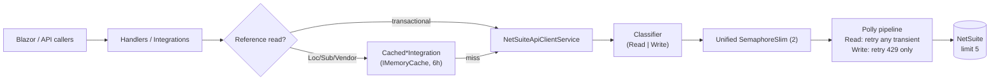

# Design — NetSuite Interim Code-Only Optimization (WMS ↔ NetSuite)

```text
Date: 2026-10-07
Status: Confirmed
Mode: FEATURE
Scope: Code-only interim NetSuite optimization — unified reduced in-process limiter, write-safe Polly retry, per-process reference-data caching. No DB, no new infra, cache-pinned packages only.
Related: .opencode/specs/2026-10-07-netsuite-concurrency-optimization (parent); sibling: requirements.md
```

## Decision Record

**Problem:** All NetSuite reads *and* writes flow through `MakeRequest`, limited only per-process at 4 — two hosts peak at 8 against an account limit of 5. No retries exist; reference reads burn slots the hot write path needs. The parent spec's gate and ledger require infrastructure (Redis/SQL) the client and environment currently forbid.

| # | Decision | Rationale | Trade-off accepted |
|---|---|---|---|
| D1 | **One static `SemaphoreSlim` shared by both request paths; default size 2; env-configurable** (`NETSUITE_MAX_INFLIGHT_PER_PROCESS`, pattern of `:94-98`) | 2 hosts × 2 = worst case 4 ≤ limit 5; one semaphore prevents 2+2 summing back to 4/process | Per-process, not a true account-wide gate; queues under burst (bounded by 100 s HTTP timeout); env change needs restart (static init) |
| D2 | **Polly 8.4.2 pinned** (exact cached version) | Only offline-restorable version | Version lock until downloads are possible |
| D3 | **Writes retry on 429 only**; `NetSuiteTransientException` gains `StatusCode` property so the predicate can distinguish | 429 = concurrency-rejected = never executed = the only duplicate-safe retry without a ledger | Timeout/5xx writes surface immediately as errors instead of auto-recovering |
| D4 | **Read/write classified by URL + method** (`/query/v1/` or GET → Read; else Write), with explicit override parameter | SuiteQL reads use POST (`:767`, `:782`) — method alone misclassifies them | A future endpoint that breaks the URL rule must pass the override explicitly |
| D5 | **Retry executes inside the permit hold** (pipeline wraps send, not the acquire) | Re-acquiring between attempts risks starvation/deadlock at size 2; holding is simple and correct | A retrying call pins its permit ~5 s extra during 429 storms |
| D6 | **Per-process `IMemoryCache` decorators, 6 h TTL, parent D7 key shape, restart-to-flush** | Zero infra; frees slots for writes; key shape keeps the Redis swap mechanical | Staleness up to 6 h; per-user access changes lag; no central flush |
| D7 | **Cache stores DTO references, no deep copy** | `IMemoryCache` needs no serialization; grids don't mutate these DTOs in practice | If a caller ever mutates a cached DTO, others see it — revisit then |
| D8 | **Test seams: internal injectable sender (extends the existing `:181-212` pattern) + internal URL-root overrides; WireMock.Net 1.7.4 for scripted statuses; Trait-gated load test** | `_httpClient` and URL roots are static (`:75`, `:58-62`, `:125`) — untestable without seams; `InternalsVisibleTo` already exists (csproj `:66-68`) | Internals exposed to the test assembly |

## What Already Exists (verified 2026-10-07, build green)

| Component | Evidence | Role in design |
|---|---|---|
| In-process limiter | `NetSuiteApiClientService.cs:253` — `new(4,4)`, used only in `MakeRequest` (`:301`/`:379`) | Becomes the unified limiter; size from env, default 2; also wraps OAuth1 |
| OAuth2 path | `MakeRequest` `:293-381`; typed errors via factory at `:369`; network mapping `SendRequestAsync` `:388-406` | Retry pipeline wraps this body (D5) |
| OAuth1 path | `MakeRequestOAuth1` `:455-570`, **ungated, no active callers** | Gains limiter + retry wrapping (insurance) |
| Typed exceptions | `Integration.NS/Exceptions/` — 3 classes + `NetSuiteExceptionFactory` (`:41-52`) | `NetSuiteTransientException` gains `StatusCode` (D3); factory sets it |
| Env-config precedent | `GetHttpTimeoutSeconds()` `:94-98` | Limiter-size parsing mirrors this |
| Token test seam | injectable sender at `:181-212`; `InternalsVisibleTo` in `Integration.NS.csproj:66-68` | Extended for request-path tests (D8) |
| DI | `NSServicesDI.cs:12-21`; three targets at `NSImplementationDI.cs:45-47` (`TryAddTransient`) | Concretes + decorated interfaces registered; `AddMemoryCache()` added to `NSServicesDI` |
| Reference interfaces | `ILocationIntegration` (8 methods; per-user `:14-15`), `ISubsidiaryIntegration` (5), `IVendorIntegration` (6) | Decorator targets; every method is a cacheable reference read |
| Current-user claim | `AuthenticationController.cs:82` (`com.direcbusiness.wms.nsEmployeeId`) | Key scope for `GetCurrentUserAllowedLocations` (no employeeId param) |
| Test project | `Integration.NS.Tests` — xunit 2.9.2, token + factory tests green | Home for all new tests (Req 4.1) |
| SuiteQL roots | `SuiteQLRoot :125`, restlet URLs `:58-62` | Classifier input (D4); test URL overrides (D8) |

**What changes:** `NetSuiteApiClientService` (limiter, retry wrapping, signatures gain optional params), `NetSuiteTransientException` + factory (`StatusCode`), `NSImplementationDI.cs:45-47` + `NSServicesDI.cs` (decorator wiring), new `Integration.NS/Resilience/` and `.../Implementations/Others/Caching/` folders, new tests. **What doesn't:** payloads, restlet scripts, UI flows, error message strings, transactional integrations, `INetSuiteApiClientService` method signatures (new params are optional), `NSImplementationDI.cs:58` double registration (parent O4 — untouched).

## Architecture Overview



## Components & Contracts

**1. Unified limiter** (edit `NetSuiteApiClientService`)
- Replace `:253` with size from `internal static int GetMaxInFlightPerProcess()` — env `NETSUITE_MAX_INFLIGHT_PER_PROCESS`, parse-fallback 2, minimum 1.
- `MakeRequestOAuth1`: acquire before `SendRequestAsync` (`:548`), release in `finally`. Token refresh stays outside the limiter (Req 1.4's documented exception).

**2. Retry** (new `Integration.NS/Resilience/`)
- `enum NetSuiteRequestKind { Read, Write }`; `enum NetSuiteRetryProfile { Interactive }` (Worker reserved for parent spec).
- `NetSuiteRequestClassifier.Classify(string url, HttpMethod method)` → `GET` or URL contains `/query/v1/` (ordinal-ignore-case) → `Read`; else `Write`.
- `static class NetSuitePipelines` — two cached `ResiliencePipeline`s: `InteractiveRead` (ShouldHandle: any `NetSuiteTransientException`) and `InteractiveWrite` (ShouldHandle: `NetSuiteTransientException { StatusCode: 429 }`). Both: `MaxRetryAttempts = 1`, `Delay = 5 s`, `Constant` backoff, `UseJitter = true`.
- Signatures gain optional params: `MakeRequest<T>(url, body, method, NetSuiteRequestKind? kind = null, NetSuiteRetryProfile profile = Interactive)` — same for OAuth1. `kind ??= Classify(url, method)`.
- Structure: acquire → `try { return await pipeline.ExecuteAsync(_ => SendAndHandle(...)); } finally { Release(); }` (D5). `SendAndHandle` = existing `:305-375` body.

**3. Exception change** — `NetSuiteTransientException` gains `HttpStatusCode? StatusCode { get; }` (new optional constructor param); `NetSuiteExceptionFactory.CreateForStatus` populates it; `CreateForNetworkError` leaves null. Messages untouched (Req 2.1).

**4. Cache decorators** (new `Integration.NS/Implementations/Others/Caching/`)
- `CachedLocationIntegration`, `CachedSubsidiaryIntegration`, `CachedVendorIntegration` — wrap the concretes + `IMemoryCache` (+ `IHttpContextAccessor` for the per-user location methods).
- Key: `ns:cache:v1:{Interface}:{Method}:{SHA256(json(intent) + scalarParams + employeeScope)}` (D6). Per-user scope: `employeeId` param when present, else the `nsEmployeeId` claim; **claim absent → skip caching** (safe fallback, never cross-user leakage).
- Hit → return; miss → call inner, store with 6 h absolute expiry.
- Registration: `NSImplementationDI.cs:45-47` become concrete registrations (`LocationIntegration`, etc.) + decorated interface factories; `NSServicesDI` gains `services.AddMemoryCache()`.

**5. Test seams** — `internal static` HttpClient override + URL-root overrides on `NetSuiteApiClientService`; used only by `Integration.NS.Tests` (D8).

## Correctness Properties

1. **Cap:** N=30 parallel mixed calls never exceed the configured limiter size in flight. *(Req 1.1–1.3, AC1)*
2. **Single limiter:** concurrent OAuth1 + OAuth2 bursts share one counter (sum ≤ size). *(Req 1.2)*
3. **Write-429:** scripted 429→200 on a write = exactly 2 attempts, result returned, no error surfaced. *(Req 2.2–2.3, AC2)*
4. **Write non-429:** scripted 500 or forced timeout on a write = exactly 1 attempt; `NetSuiteTransientException` surfaces. *(Req 2.3, AC3)*
5. **Read transient:** scripted 500→200 on a SuiteQL read = exactly 2 attempts. *(Req 2.4, AC4)*
6. **Validation:** 400 = 1 attempt, `NetSuiteValidationException`, message byte-identical to current. *(Req 2.1, AC5)*
7. **Classification:** SuiteQL-POST→Read; record-POST→Write; GET→Read; explicit override wins. *(Req 2.5)*
8. **No permit leak:** after a timed-out call, later calls proceed (finally-release). *(Req 1.5)*
9. **Cache discipline:** identical read twice → 1 NetSuite call; differing intent/employee → 2 calls; transactional integration → always calls through. *(Req 3.1–3.3, AC6–AC7)*
10. **Config:** env override changes the observed cap; invalid value falls back to 2. *(Req 1.3, AC8)*

## Error Handling & User-Visible Behavior

- **Write + 429:** silent retry after ~5 s jitter; success returns normally; second failure → existing parsed error.
- **Write + timeout/5xx:** immediate existing parsed error (never retried — duplicate protection).
- **Read + transient:** one silent retry, then existing error.
- **Busy period:** calls queue on the limiter (bounded by the 100 s timeout) instead of erroring — the intended UX change.

## Testing Strategy

- **Unit** (`Integration.NS.Tests`): classifier matrix, pipeline predicates (StatusCode 429 vs 500 vs network), key-builder determinism + discrimination, env parsing, factory sets `StatusCode`.
- **Integration** (WireMock 1.7.4 via D8 seams): properties 1–9 — concurrency counting handler for caps; WireMock scenario state (429→200) for retries; forced `TaskCanceledException` for timeout paths.
- **Load** (Trait `Category=Load`, excluded from default runs): 30 parallel posts, 100 ms fake latency — asserts cap ≤ 2 per instance and exact attempt counts (no duplicate writes).
- **Regression:** login with NS claims, four form save flows, reference grids, transactional reads — manual/E2E pass; full `dotnet build` + `dotnet test` green.

**Property-based testing: NOT APPLICABLE.** Properties are concurrency/protocol invariants best proven by deterministic scripted tests; key-hashing is covered by deterministic unit tests; there is no data algebra to generate over.

## Accepted Consequences

- Worst case 4 account-wide assumes exactly two NetSuite-calling hosts; a new host requires env tuning (documented in tasks).
- A retrying call holds its permit through the ~5 s delay (D5).
- Reference data staleness up to 6 h; flush = restart (D6).
- OAuth1 gating is insurance — no active callers today.
- Limiter size changes require process restart.

## Out-of-Scope (restated)

Any DB change (ledger/worker/status/pilot — parent spec, pending an allowed store); Redis and true account-wide gate of 3; Testcontainers/NBomber/StackExchangeRedis packages; NetSuite-side changes; Worker retry profile; `NSImplementationDI.cs:58` cleanup.

## Verification Checklist

☐ Build green ☐ All new unit tests green ☐ Cap ≤2 proven (both paths combined) ☐ Write-429 retried / write-timeout not retried ☐ Read-5xx retried ☐ 400 never retried, message identical ☐ Cache hit/miss + per-user isolation ☐ Transactional uncached ☐ Env override honored ☐ Load harness: cap + zero duplicate attempts ☐ Regression: login, four forms, grids ☐ No committed secrets
