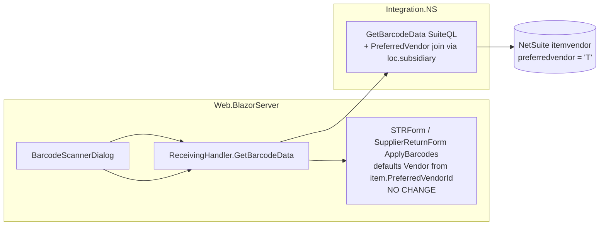

# Design Document: Barcode Path Preferred Vendor Defaulting

## Decision Record

**Problem.** Lines created by barcode scanning get no Preferred Vendor default
because the barcode lookup query never selects the item's preferred vendor,
while the picker path does.

| # | Decision | Rationale |
|---|----------|-----------|
| D1 | Fix only the integration query + NSDTO + mapping; make **zero form changes** | `STRForm.razor.cs:490` and `SupplierReturnForm.razor.cs:411-420` already default from `item.PreferredVendorId`; they are fed empty data today. Smallest possible blast radius; no prior fix is touched. |
| D2 | Reuse `SuiteQLFragments.PreferredVendor()` unchanged, called unscoped, constrained in the **join predicate**: `pv.item = item.id AND pv.subsidiary = loc.subsidiary` | `GetBarcodeData` receives only a location, not a subsidiary. The `location` table carries its owning subsidiary, so a per-row predicate resolves the document subsidiary without a new parameter. Avoids prior-spec regression S1 (unscoped join duplicating multi-subsidiary items) because the outer query is pinned to one barcode + one location, and the predicate keeps the vendor join 1:1. |
| D3 | Select `pv.vendor` (raw id) + `BUILTIN.DF(pv.vendor)` (name) | Exact precedent: `ItemsIntegration.cs:97-98` and prior-spec design (header read pattern). |
| D4 | Map into the nested `BarcodeDTO.Item` (`ItemsDTO`) manually in the existing `Adapt` block | `GetBarcodeData` already constructs `Item` by hand (`ReceivingIntegration.cs:773-784`); adding two assignments matches the local style. Downstream `ItemsDTO → ItemsVM` maps by name automatically (Mapster), so `BarcodeVM.Item.PreferredVendorId` populates with no new mapping code. |

**Trade-offs.** (a) `loc.subsidiary` scoping assumes the location's owning
subsidiary is the correct vendor scope — consistent with prior spec R3
(source-subsidiary precedent) and with the picker path, which passes the
document/source subsidiary. (b) One extra derived-table join per barcode
lookup — negligible: the query returns a single row and the fragment is the
same one the picker already materializes.

## What Already Exists (verified)

- Barcode query: `ReceivingIntegration.cs:742-767` — joins `PreferredBin(location)` at `:763`; filters `b.name = barcode` + `loc.id = location` at `:764-767` (single-row result).
- Manual DTO mapping: `ReceivingIntegration.cs:773-784` (nested `Item` construction).
- `BarcodeNSDTO` (`Integration.NS/DataTransferObjects/Receiving/BarcodeNSDTO.cs:10-23`) — has `PreferredBin`, no vendor fields.
- `BarcodeDTO.Item` is `ItemsDTO` (`Application.DataTransferObjects/Others/ItemsDTO.cs:19-20` — `PreferredVendorId/Name` already exist).
- `BarcodeVM.Item` is `ItemsVM` (`Web.BlazorServer/ViewModels/Others/ItemsVM.cs:15-16` — already exist).
- Form defaulting (no change): `STRForm.razor.cs:482-494`, `SupplierReturnForm.razor.cs:409-432`.
- Fragment: `SuiteQLFragments.PreferredVendor` (`SuiteQLFragments.cs:63-71`) exposing `item, vendor, subsidiary`.

**What changes:** one query (2 selects + 1 join), one NSDTO (+2 fields), one mapping block (+2 assignments).
**What does not change:** forms, `BarcodeDTO`/`BarcodeVM`/`ItemsDTO`/`ItemsVM`, `SuiteQLFragments`, `BarcodeStore`, verifiers, picker query, all other barcode consumers.

## Overview & Data Flow

Scan → `GetBarcodeData` returns item **with** `PreferredVendorId/Name` →
`BarcodeStore` → `ApplyBarcodes` creates the line → existing defaulting code
picks it up. No new components, no new seams.

## Correctness Properties

- **P1** (2.1): For any barcode whose item has a preferred vendor in the scanned location's subsidiary, `GetBarcodeData` returns `PreferredVendorId/Name` equal to that master row; a new line from `ApplyBarcodes` carries that vendor.
- **P2** (2.2): For any barcode whose item has no preferred vendor in that subsidiary, the fields return null and the line vendor is null (submit guard still applies).
- **P3** (1.2/3.2): The query returns exactly one row per (barcode, location) — the vendor join never multiplies rows.
- **P4** (2.3): Header-vendor-wins precedence in `SupplierReturnForm.ApplyBarcodes` is unchanged and still overrides the master default.
- **P5** (3.1): Picker-path defaulting is byte-identical (`ItemsIntegration.cs` untouched).
- **P6** (3.4): For forms without a vendor field, the added join/selects are inert — returned `BarcodeVM` differs only in the two new fields.

## Error Handling

No new paths. Unknown barcode → existing null → "Couldn't find data" toast. Field drift (e.g., `loc.subsidiary` absent) would surface as a SuiteQL error through the existing integration → handler → dialog toast path, caught in DEV verification.

## Testing Strategy

**Limitation (per skill rules): no test projects exist in `WMS.slnx`; no
automated tests are introduced** (matches prior spec). Verification is
`dotnet build` + manual DEV matrix:

1. **Demonstrate defect (pre-fix):** scan an item with a known preferred vendor into a new STR line → vendor empty (1.1).
2. **Verify fix:** same scan post-fix → vendor defaulted, equal to the picker path's default for the same item + location (P1).
3. **No-vendor item:** scan → vendor null → submit blocked with line number (P2).
4. **RTS precedence:** with header vendor set, scan → header vendor wins (P4).
5. **Regression:** picker add, preferred bin display, quantity/UoM resolution, and one non-vendor form (e.g., Receiving scan) behave as before (P5, P6).

**PBT assessment: NOT APPLICABLE** — no test infrastructure exists; behavior is NetSuite-integration-bound (external system), not pure logic.

## Blast Radius

`ReceivingIntegration.GetBarcodeData`, `BarcodeNSDTO`. All nine `BarcodeScannerDialog` consumers share the query; only STR and RTS read the vendor fields — the rest are inert (P6). No schema, no NS-side change, no payload change.

## Accepted Consequences & Out-of-Scope

- Multi-preferred-vendor-per-subsidiary items may pick an arbitrary row (R2, same as picker path — accepted in prior spec).
- Inventory Worksheet scanning not covered (no vendor field on that document).
- Verification checklist before merge: DEV scan test matrix above; confirm `loc.subsidiary` resolves on the DEV location record.
