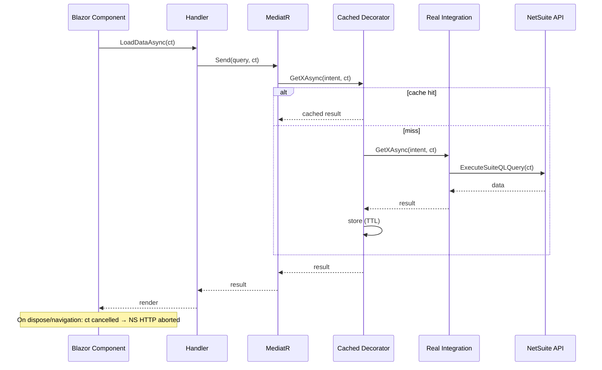

# Design: Web Data-Fetch Optimization

**Date:** 2026-10-08
**Status:** Confirmed
**Mode:** FEATURE
**Scope:** Web.BlazorServer, Integration.NS, Application.UseCases
**Related:** requirements.md (same folder)

## Decision Record

- **D1 — Cache decorators, not handler changes.** Extend the existing `Cached*Integration` decorator pattern (`NSImplementationDI.cs:56-66`) to warehouses, school years, transfer types, transaction types, departments, and grid-heavy reference reads. Rationale: zero changes to Blazor pages/handlers; cache lives at the integration boundary where NetSuite calls originate.
- **D2 — `IMemoryCache` is process-wide, not per-circuit.** `AddMemoryCache()` (`NSServicesDI.cs:18`) registers a singleton. Requirement 2.4 is satisfied by keying: include user/subsidiary in the key where data varies by caller (same approach as `CachedLocationIntegration` using `IHttpContextAccessor`). Grid cache keys include the user's circuit identifier.
- **D3 — Single-flight via `SemaphoreSlim` per key.** `NsCacheExtensions.GetOrAddAsync` (`NsCacheExtensions.cs:19-33`) has a race: two concurrent misses both call NetSuite. Add a per-key lock dictionary.
- **D4 — Cancellation flows via `CancellationToken` parameters.** Add `CancellationToken ct = default` to handler methods, MediatR queries, integration interfaces, and `NetSuiteApiClientService.ExecuteSuiteQLQuery`. Blazor components pass a `CancellationTokenSource` cancelled in `DisposeAsync`.
- **D5 — Debounce in the component code-behind.** A small `Debouncer` helper (Shared.Libraries) used by `ItemDataGrid` and `QuickVirtualizedDropdown`; Enter/blur bypasses the delay.
- **D6 — Grid cache TTL short (60s), invalidated on mutations.** Mutation handlers call a `IGridCacheInvalidator` that removes entries by entity prefix.

## What Already Exists

- `CachedVendorIntegration`, `CachedSubsidiaryIntegration`, `CachedLocationIntegration` — decorator template.
- `NsCacheKey.Build(...)` — key builder (includes full intent; for reference data we key by method + subsidiary only).
- `NsCacheExtensions.GetOrAddAsync` — cache helper (needs single-flight fix).
- `IMemoryCache` registered; `IHttpContextAccessor` available.
- `DataGridIntent` carries filters/sort/skip/take — grid cache key = hash of its serialized form + user id.
- `QuickVirtualizedDropdown.razor.cs:54-90`, `ItemDataGrid.razor.cs:106-118` — debounce targets.
- Handlers like `DeliveryHandler.cs:19` call `sender.Send(qry)` without `ct` — must be updated.

**What changes:** new cached decorators for reference integrations; `GetOrAddAsync` gains single-flight; `CancellationToken` added through the chain; `Debouncer` helper + two components updated; grid-result cache decorator on live transactional integrations (skip `NotImplementedException` stubs).

**What does not change:** Blazor page structure, Radzen grid wiring, pagination/sort/filter semantics, SAP project, API controllers' contracts.

## Architecture

## Correctness Properties

- **P1** (Req 1.1, 1.2): A second identical reference-data request within TTL SHALL NOT produce a NetSuite HTTP call.
- **P2** (Req 1.3): After a mutation, the next reference-data request SHALL hit NetSuite (cache evicted).
- **P3** (Req 1.4): N concurrent identical misses SHALL produce exactly 1 NetSuite call.
- **P4** (Req 2.1, 2.4): Two users requesting the same grid intent SHALL NOT share cached entries.
- **P5** (Req 3.1, 3.3): Cancelling the component's token SHALL abort the in-flight HTTP request and SHALL NOT surface an error to the user.
- **P6** (Req 4.1, 4.3): Typing 5 characters within 400ms SHALL produce exactly 1 query, and any in-flight query SHALL be cancelled.
- **P7** (Req 5.1): For any intent, cached and uncached grid results SHALL be identical (same data, same count).

## Error Handling

- Cancelled fetches: swallow `OperationCanceledException` in components; no error UI.
- Cache factory failure: do NOT cache exceptions; next request retries NetSuite.
- NetSuite failure: existing handler error behavior preserved.

## Testing

- Unit: `NsCacheExtensions` single-flight; `NsCacheKey` stability; `Debouncer` timing.
- Integration: cached decorator returns same data as inner on hit; eviction on mutation.
- Manual/UI: navigate away mid-load → no error toast; rapid typing → single network call.
- Property-based testing: **NOT APPLICABLE** — behavior is timing/cache-lifecycle, not pure functions over varied inputs.

## Verification Checklist

- [ ] Reference-data pages load without NetSuite calls on second visit.
- [ ] Grid back-navigation within 60s shows cached data.
- [ ] Navigating away cancels in-flight requests.
- [ ] Typing in dropdown filter fires one query after 400ms pause.
- [ ] `dotnet build` succeeds; existing tests pass.
