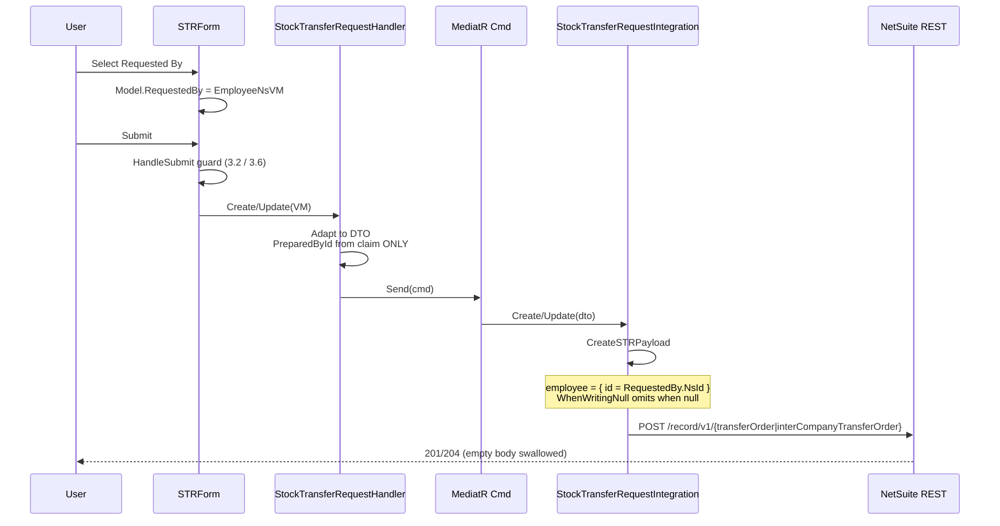
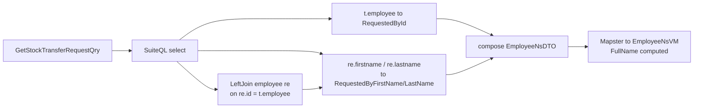

# Design Document

## 1. Decision Record

### D-1 — Source the dropdown from the existing employee query path

**Problem:** Requested By needs a NetSuite employee picker.

**Decision:** Reuse `IUserManagementHandler.GetAllEmployeesAsync` →
`GetAllEmployeesQry` → `EmployeeNsDTO` → `EmployeeNsVM`. Inject
`IUserManagementHandler` into `STRForm`.

**Rationale:** `EmployeeNsVM` already exposes `NsId` (the NetSuite internal id —
exactly what the payload needs) and a computed `FullName` suitable for
`FilterTarget`. Reuse satisfies Requirement 3.9.

**Trade-off:** Couples the dropdown to a list filtered to WMS-tagged employees
(`EmployeeIntegration.cs:27-32`). Subsidiary scoping would later be a provider
change, not a model change. Deliberately not built now (out of scope).

### D-2 — Model Requested By as an object, not a string

**Problem:** `PreparedBy` is a `string` (`StockTransferRequestInfoVM.cs:18`),
which is what forces the read-only TextBox at `STRForm.razor:304`.

**Decision:** Add `EmployeeNsVM? RequestedBy` to the VM and
`EmployeeNsDTO? RequestedBy` to the DTO.

**Rationale:** A user-selectable field needs a stable id for the payload plus a
name for display. A string cannot round-trip an internal id. The
`VendorVM`/`LocationVM` shape is the established convention.

**Trade-off:** Mapster must now hydrate a nested object on the read path where
Prepared By relied on a flat string.

### D-3 — Return both id and name on the read path

**Problem:** `PreparedById` is never selected on read
(`StockTransferRequestIntegration.cs:157` selects only the name;
`StockTransferRequestHeaderNSDTO` has no id property). Consequence: on update the
value is null and the key is omitted.

**Decision:** `StockTransferRequestHeaderNSDTO` gains `RequestedByFirstName`,
`RequestedByLastName`, and `RequestedById`, projected from the second
`employee` join and from `t.employee`.

**Rationale:** Requirement 3.7. Explicitly building all three is the whole point
of this design — it is the defect to avoid repeating.

**Trade-off:** Slightly more DTO surface than strictly needed for display.

### D-4 — Second `employee` join alias

**Problem:** `employee e` is already bound to prepared-by at line 183.

**Decision:** Add `.LeftJoin("employee re", on: "re.id = t.employee")`.

**Rationale:** The two fields are distinct columns on the same table. Reusing
alias `e` would break Prepared By.

**Trade-off:** One extra join per header/list query. Negligible against the
existing `transaction` / `transactionline` / `employee` join set.

### D-5 — Entity-reference object form in the payload

**Problem:** Line 378 posts `custbody_dbti_prepared_by` as a bare int; lines
360-374 post `subsidiary` / `location` / `transferLocation` as `{ id = "..." }`.

**Decision:** Post
`employee = dto.RequestedBy is not null ? new { id = dto.RequestedBy.NsId.ToString() } : null`.

**Rationale:** NetSuite accepts both for entity references, but the object form
is what the rest of this payload uses. Consistency matters here because the
surrounding serializer is non-default (`CamelCase` + `WhenWritingNull`).

**Trade-off:** None.

### D-6 — Validate in `HandleSubmit`, not via `RadzenRequiredValidator`

**Problem:** Requirements 3.2 and 3.6 need submission blocking.

**Decision:** Add an explicit guard in `STRForm.razor.cs:97` `HandleSubmit`,
following the existing per-line vendor pattern at lines 115-124.

**Rationale:** `HandleSubmit` is the single gate shared by create and update, so
one guard covers both AC-2 (create) and AC-7 (legacy update). A
`RadzenRequiredValidator` would require a `Name` on the dropdown and would not
produce the same message quality. The existing comments at lines 111-114
explicitly justify this choice for cross-cutting validation.

**Trade-off:** Imperative check rather than declarative. Consistent with the
surrounding code.

### D-7 — Add no new editability logic

**Problem:** Requirement 3.3 says editable only while draft.

**Decision:** Add no new gating code.

**Rationale:** Already enforced structurally — verified:

- `StockTransferRequestView.razor:30` passes `ReadOnly` → read-only render
- `StockTransferRequestUpdate.razor:28` passes `EditMode` without `ReadOnly` → editable
- `StockTransferRequestUpdate.razor:83-84` throws before load if `!response.IsEditable`
- `IsEditable` = `!IsSubmittedForApprovals && (StatusId == 3 || StatusId == 2)`
  (`StockTransferRequestIntegration.cs:207`)

A submitted STR cannot be reached in edit mode. The dropdown binds with the
standard `Visible="@(!ReadOnly)"` / `Visible="@ReadOnly"` pair, matching Vendor
(`STRForm.razor:83-93`).

**Trade-off:** The grid's conflicting `IsEditable`
(`StockTransferRequestDataGridNSDTO.cs:28`) stays wrong. Out of scope,
preserved as-is.

### D-8 — Test through the existing NetSuite test Fakes, not by widening visibility

**Problem:** `CreateSTRPayload` is `private` (line 356).

**Decision:** Do not change its visibility. Construct
`StockTransferRequestIntegration` with `CapturingNetSuiteClient` and assert on
the captured request body.

**Rationale:** `Integration.NS.Tests/Fakes/` already provides
`CapturingNetSuiteClient`, `CountingNetSuiteClient`, `MutatingNetSuiteClient`,
and `CachedReferenceIntegrationTests.cs:33-38` demonstrates the exact
construction pattern. Testing the public method asserts the real wire payload,
which is what actually matters.

**Trade-off:** Tests assert JSON substrings rather than a typed object. Slightly
brittle to formatting, but it verifies the true contract.

### D-9 — Split the employee name on the header path, flatten it on the grid path

**Problem:** The read path needs a display name, and `EmployeeNsVM` exposes no
`Name` property — only `FirstName`, `LastName`, and a computed `FullName`
(`EmployeeNsVM.cs:3-14`).

**Decision:** Project `re.firstname` and `re.lastname` separately into the header
NS DTO and compose an `EmployeeNsDTO`; project a single concatenated string for
the grid NS DTO.

**Rationale:** A flat `RequestedByName` string on `EmployeeNsDTO` would be
silently dropped by Mapster (no matching property on `EmployeeNsVM`), leaving
`FullName` empty and the dropdown blank on every loaded document. Composing
First/Last keeps `FullName` computable and requires **zero** changes to the
shared employee types used by authentication, user management, and
`EmployeeNsVO`. This also avoids the re-resolution round-trip seen at
`UserManagementCVU.razor.cs:131-132`.

The grid path flattens because grid columns bind to strings and `PreparedBy` on
`StockTransferRequestDataGridNSDTO.cs:21` is already a flat string — the two
surfaces follow their own established conventions.

**Trade-off:** Two SuiteQL columns instead of one on the header query. Negligible.

## 2. What Already Exists (verified)

| Concern | Location |
|---|---|
| STR handler interface | `Web.BlazorServer/Handlers/Repositories/Transaction/StockTransferRequest/IStockTransferRequestHandler.cs` |
| STR handler (claim → PreparedById) | `Web.BlazorServer/Handlers/Implementations/Transaction/StockTransferRequest/StockTransferRequestHandler.cs:74-96` |
| Create / Update commands | `Application.UseCases/Commands/Transaction/StockTransferRequest/Create…Cmd.cs`, `Update…Cmd.cs` |
| Integration interface | `Application.UseCases/Repositories/Integration/Transaction/StockTransferRequest/IStockTransferRequestIntegration.cs` |
| NS integration (queries + payload) | `Integration.NS/Implementations/Transactions/StockTransferRequestIntegration.cs` |
| Header NS DTO | `Integration.NS/DataTransferObjects/StockTransferRequest/StockTransferRequestHeaderNSDTO.cs` |
| Grid NS DTO | `Integration.NS/DataTransferObjects/StockTransferRequest/StockTransferRequestDataGridNSDTO.cs` |
| App DTO / VM | `Application.DataTransferObjects/Transactions/StockTransferRequest/StockTransferRequestInfoDTO.cs`, `Web.BlazorServer/ViewModels/Transaction/StockTransferRequest/StockTransferRequestInfoVM.cs` |
| Employee model (reused) | `EmployeeNsVM.cs`, `EmployeeNsDTO.cs`, `EmployeeNsVO.cs` |
| Employee query | `Application.UseCases/Queries/Others/GetAllEmployeesQry.cs` → `IUserManagementHandler.cs:10` |
| Employee integration (WMS filter) | `Integration.NS/Implementations/Others/EmployeeIntegration.cs` |
| Shared form (create/update/view) | `Web.BlazorServer/Components/Pages/Transaction/StockTransferRequest/Components/STRForm.razor(.cs)` |
| Shared grid (all 3 tabs) | `…/StockTransferRequest/Components/STRDataGrid.razor` |
| List cache wrapper | `Integration.NS/Implementations/Others/Caching/CachedStockTransferRequestIntegration.cs` |
| Mapster registration | `Application.UseCases/Registers/MappingRegistration.cs` |

**Changes:** 8 files.

**Does not change:** no EF/migration, no new endpoints, no new handler method,
no new employee retrieval, no command changes, no
`IStockTransferRequestIntegration` signature change.

## 3. Architecture & Flow



**Read path (id and name both returned):**



## 4. Components & Contracts

### 4.1 ViewModels — `StockTransferRequestInfoVM.cs`

Add `public EmployeeNsVM? RequestedBy { get; set; } = null;`.
`using Web.BlazorServer.ViewModels.Others;` already present (line 3).

### 4.2 DTOs

- `StockTransferRequestInfoDTO.cs` — add `public EmployeeNsDTO? RequestedBy { get; set; } = null;`
- `StockTransferRequestHeaderNSDTO.cs` — add `RequestedByFirstName`, `RequestedByLastName` (string) and `RequestedById` (int)
- `StockTransferRequestDataGridNSDTO.cs` — add `public string RequestedBy` (name only; grid needs no id)
- `StockTransferRequestDataGridDTO.cs` — add `public string RequestedBy`

### 4.3 Integration read path — `StockTransferRequestIntegration.cs:153-179`

Add to `.Select(...)` after line 178:

```
("re.firstname", nameof(StockTransferRequestHeaderNSDTO.RequestedByFirstName)),
("re.lastname",  nameof(StockTransferRequestHeaderNSDTO.RequestedByLastName)),
("t.employee",   nameof(StockTransferRequestHeaderNSDTO.RequestedById)),
```

Add join immediately after line 183:

```
.LeftJoin("employee re", on: "re.id = t.employee")
```

Compose the nested object after the `Adapt` at line 196, beside lines 198-206:

```csharp
dto.RequestedBy = nsdto.RequestedById > 0
    ? new EmployeeNsDTO
    {
        NsId = nsdto.RequestedById,
        FirstName = nsdto.RequestedByFirstName,
        LastName = nsdto.RequestedByLastName
    }
    : null;
```

`using Application.DataTransferObjects.Others;` is **not** currently imported in
this file — verify and add if required.

### 4.4 Integration payload — `StockTransferRequestIntegration.cs:356-404`

Add to the anonymous object beside line 378:

```csharp
employee = dto.RequestedBy is not null ? new { id = dto.RequestedBy.NsId.ToString() } : null,
```

The `CamelCase` policy leaves the lowercase key `employee` unchanged.
`WhenWritingNull` (line 353) omits it when null — this is what makes "required
on create, preserved on edit, never clearable" work.

### 4.5 Handler — `StockTransferRequestHandler.cs:74-96`

**No new logic.** `RequestedBy` flows VM → DTO via `Adapt`. `PreparedById`
remains claim-derived on create (lines 78-81) and unset on update (lines 88-96) —
preserved per Requirements 5.1 and 5.2.

### 4.6 Form — `STRForm.razor`

Place in the **Details** fieldset (not "Additional Details"), adjacent to
Purchase Category (lines 83-101) — Requested By is header capture data, not
supplementary text. Mirrors the Vendor pattern:

- Inject `IUserManagementHandler UserManagementHandler`
- `readonly string ActionGetEmployees = "Get Employees";`
- Provider:

```csharp
async Task<(IEnumerable<EmployeeNsVM>, int)> EmployeeProvider(DataGridIntent intent)
    => await UserManagementHandler.GetAllEmployeesAsync(intent);
```

- Markup: `RadzenTextBox` visible when `ReadOnly`; `QuickVirtualizedDropdown`
  visible when `!ReadOnly`, with `Name="str_requested_by"`, `TItem="EmployeeNsVM"`,
  `FilterTarget="@nameof(EmployeeNsVM.FullName)"`,
  `TextProperty="@nameof(EmployeeNsVM.FullName)"`, `AllowFiltering`,
  `AllowClear="false"` (Required — enforces "never clearable" at the control
  level, matching the payload semantics).

### 4.7 Form validation — `STRForm.razor.cs:97`

Insert into `HandleSubmit`, after the line-vendor check at line 124:

```csharp
if (Model.RequestedBy is null)
{
    ToastService.Error("Please select a Requested By employee", "Error");
    return;
}
```

Covers AC-2 (create) and AC-7 (legacy update) in one place per D-6.

### 4.8 Grid — `STRDataGrid.razor` + 3 queries

- Add a `RequestedBy` column beside `PreparedBy` (lines 78-81), filterable and
  sortable.
- All **three** list queries need the projection + join, or AC-8 fails on 2 of 3
  tabs:
  - `GetIntercompanyTransferOrderList` — select after line 47, join after line 52
  - `GetReturnsList` — select after line 89, join after line 93
  - `GetTransferOrderList` — select after line 127, join after line 132

  Each already has a `LeftJoin("employee e", …)`; add the `re` alias alongside.

`Adapt` maps the flat grid string automatically — no conversion code.

## 5. Correctness Properties

| # | Property | Reqs |
|---|---|---|
| P-1 | Every create payload for which `RequestedBy` is non-null contains `employee.id` equal to `RequestedBy.NsId`, as a string | 3.5, AC-3 |
| P-2 | When `RequestedBy` is null, the serialized payload contains **no** `employee` key | 3.6, 5.4 |
| P-3 | The header query selects `t.employee` and joins `employee re` on `re.id = t.employee`; the alias `e` remains bound to `custbody_dbti_prepared_by` | 3.7, 5.2 |
| P-4 | All three list queries select Requested By, so the column is non-empty on all three tabs | 3.8, AC-8 |
| P-5 | `HandleSubmit` returns before invoking `OnSubmit` whenever `RequestedBy` is null | 3.2, 3.6, AC-2, AC-7 |
| P-6 | No NetSuite request is issued when P-5 trips | AC-2 |
| P-7 | A Draft STR round-trips Requested By id through read → edit → update without loss | 3.3, 3.7, AC-4, AC-6 |
| P-8 | Editing an STR without touching Requested By produces a payload whose `employee.id` equals the originally stored id | AC-10 |
| P-9 | The payload for create and update are produced by the same `CreateSTRPayload`, so field treatment cannot diverge | 3.5, 5.1 |
| P-10 | `CreateStockTransferRequest` still sets `PreparedById` from the claim; `UpdateStockTransferRequest` still does not | 5.1, 5.2, AC-11 |
| P-11 | A loaded STR's Requested By renders a non-empty name in the dropdown, because `EmployeeNsDTO.FirstName`/`LastName` are both populated from the read path | 3.4, 3.7, AC-4 |

## 6. Error Handling

- **Dropdown provider failure** — surfaced via `ActionName` / busy service,
  matching all other providers. No new handling.
- **NetSuite validation rejection** (e.g. malformed `employee.id`) — propagates
  through `MakeRequest` → `AppActionFactory.RunAsync` → `OnFailure`, unchanged.
  The existing swallow at lines 294 / 312 / 330 only catches the exact
  "Empty response" message, so real errors still surface.
- **Legacy record + mandatory field** — mitigated by P-5 / P-6 (blocked
  client-side) rather than relying on a NetSuite error.

## 7. Testing Strategy

Only **`Integration.NS.Tests`** exists (net8.0). No test project covers
`Web.BlazorServer` or `Application.UseCases`, so `STRForm` markup and
`HandleSubmit` logic are **not** unit-testable in this repository. Stated as a
limitation, not worked around.

**Unit/integration — `Integration.NS.Tests`**, using `CapturingNetSuiteClient`
per D-8 and the construction pattern from
`CachedReferenceIntegrationTests.cs:33-38`:

1. `Create_payload_includes_employee_id_when_requested_by_set` — P-1, AC-3
2. `Create_payload_omits_employee_key_when_requested_by_null` — P-2
3. `Update_payload_includes_employee_id` — P-1, AC-6
4. `Header_query_selects_employee_id_and_joins_re_alias` — P-3, AC-4
5. `Header_query_keeps_e_alias_on_prepared_by` — P-3, P-10
6. `Transfer_order_list_query_selects_requested_by` — P-4, AC-8
7. `Intercompany_list_query_selects_requested_by` — P-4, AC-8
8. `Returns_list_query_selects_requested_by` — P-4, AC-8
9. `Update_payload_retains_employee_when_unchanged` — P-8, AC-10

**Manual verification** (no automated home): AC-1, AC-2, AC-5, AC-7, AC-11, plus
all read-only rendering.

**Regression:** run the full existing `Integration.NS.Tests` suite; P-10 guards
Prepared By behavior.

**Commands:** `dotnet build`, `dotnet test`.

## 8. Property-Based Testing Assessment

**NOT APPLICABLE.** The change surface is deterministic serialization of a
single known field and deterministic SuiteQL string construction. There is no
generative input space, no algebraic invariant, and no stateful model to
explore. Fixed-input xUnit assertions on captured request bodies and query
strings are strictly more precise than a property-based generator here, and a
generator would add a dependency with no payoff.

## 9. Accepted Consequences

- Grid results are cached (`CachedStockTransferRequestIntegration.cs:19-29`);
  after deploy users may briefly see a grid without the new column until cache
  expiry. Operational note, not a behavior change (Req 5.5).
- The grid's `IsEditable` (line 28) remains inconsistent with the header's
  (line 207). Preserved per D-7.
- `GetReturnsList` / `GetTransferOrderList` paging inconsistency left untouched:
  both call `netsuiteService.ExecuteSuiteQLQuery` directly (lines 103, 145) while
  `GetIntercompanyTransferOrderList` uses `query.ExecuteWithPaging` (line 65).
  Commit `9ac406e` fixed this pattern elsewhere. Out of scope — flagged only.
- `STRForm.razor:86-87, 98, 112` use `Disabled="Disabled"` without `@`. This
  compiles to the same property so it works, but it reads like a typo. New
  markup uses `@Disabled`; existing occurrences are untouched.

## 10. NetSuite-Side Verification

Confirmed with the NS admin: **no approval workflow and no SuiteScript reads or
writes the standard `employee` field** on `transferorder` /
`intercompanytransferorder`. The residual risk identified during review is
therefore closed — writing `employee` has no routing or scripting side effects.

Requirement 3.9's WMS-role tag constraint (see `requirements.md` Open Item O-1)
remains outstanding.

## 11. Out of Scope

Packing STR · Inventory Transfer Request · any NetSuite-side change · Prepared By
behavior · grid `IsEditable` · backfill · dropdown subsidiary scoping · adjacent
refactors noted in §9.

## 12. Verification Checklist

- [ ] Header query returns `RequestedById`, `RequestedByFirstName`, `RequestedByLastName`
- [ ] `e` alias still bound to `custbody_dbti_prepared_by` (Prepared By unchanged)
- [ ] Create payload contains `employee: { id }`
- [ ] Null Requested By omits the key entirely
- [ ] All three list queries project Requested By
- [ ] Validation blocks submit before `OnSubmit` is invoked
- [ ] Dropdown binds with `AllowClear="false"`
- [ ] `dotnet build` clean; `dotnet test` green including the 9 new tests
- [ ] Prepared By create/update behavior unchanged (P-10)