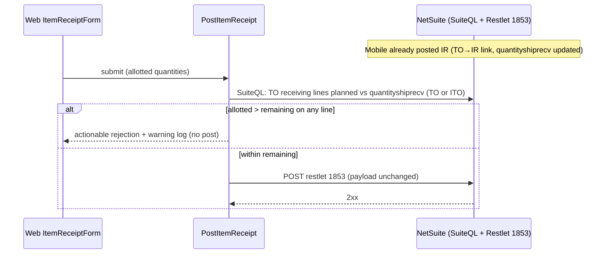

# Returns/STR Item Receipt Open-Quantity Divergence — Design Document

**Spec name:** `fix-returns-receipt-open-quantity-divergence`
**Mode:** BUGFIX
**Status:** Confirmed
**Date:** 2026-10-13
**Related:** `fix-netsuite-item-receipt-error-visibility`, `requirements.md` (sibling)

## Overview

The web item-receipt page, when opened against an Item Fulfillment, computes "already
received" from Item Receipts linked to that fulfillment (`IF_RECEIPTS_QUERY`,
`ReceivingIntegration.cs:561-572`). Mobile posts returns receipts by transforming the
Transfer Order (`NetSuiteApiClientService.cs:1018`), so those receipts are linked
TO→IR and are invisible to the IF-based sum. The resulting inflated `QuantityOpen`
(`ItemReceiptDTO.cs:68`) passes the form guard (`ItemReceiptForm.razor.cs:72`) and reaches
RESTlet 1853 as an over-receipt, which NetSuite rejects with HTTP 400.

This design replaces the IF-path received-quantity source with the TO RECEIVING line's
`quantityshiprecv` — the counter NetSuite itself maintains and the one every other channel
already reads — and adds a server-side remaining-quantity guard in `PostItemReceipt`.

## Design Considerations

- RESTlet 1853 is deployed in NetSuite, not in this repository, so its validation contract
  cannot be verified statically. The fix therefore makes the web's numbers match the
  NetSuite-maintained ledger rather than guessing at restlet behavior.
- The user's standing instruction is minimal-first: ship only what is necessary. The
  IF-dialog filtering (req 2.4) is UX hardening and is deferred.
- TO and ITO share `t.type = 'TrnfrOrd'`; only `t.recordtype` differs. All lookups already
  handle both or key off internal ids, so no recordtype branching is introduced (req 3.8).
- `PostItemReceipt` is web-only. Mobile posts via `NetSuiteApiClientService.SaveTOItemReceipt`
  (`:953`) and `SaveReturnsItemReceipt` (`:1015`), so a guard inside `PostItemReceipt`
  cannot affect mobile (P6).
- No test projects exist in the solution; verification is `dotnet build` plus manual
  sandbox scenarios, consistent with the predecessor spec.
- `IF_RECEIPTS_QUERY` returns NULL for a fulfillment with no IF→IR receipts; a
  `NVL(..., 0)` guard is needed to preserve that tolerance when it is removed.

## Requirements Traceability

| Requirement | Design element |
|-------------|----------------|
| 2.1, 3.8 | Decision 1 + Component 1 — `IF_TO_LINE_RECEIVED_QTY` from TO line `quantityshiprecv` |
| 2.2, 3.8 | Decision 2 + Component 3 — `GetTransferOrderLineRemainingAsync`, recordtype-agnostic lookup by internal id |
| 2.3 | Decision 2 + Component 3 — warning log before throw |
| 2.4 (Optional) | Deferred; Component 4 notes the extension point only |
| 3.1 | Decision 2 guard skips `SourceTypes.PurchaseOrder` |
| 3.2 | Component 1 touches only `GetItemReceiptItemFulfillmentLinesAsync` |
| 3.3, 3.4 | No changes to `NetSuiteApiClientService` or payload builders |
| 3.5 | No changes to `NetSuiteApiClientService` throw sites |
| 3.6 | `IF_TO_LINE_ID` selection and the orderLine=0 guard are untouched |
| 3.7 | Accepted consequence — conservative under-offer |
| 3.8 | Single code path; `recordtype IN ('transferorder','intercompanytransferorder')` |

## Root Cause

### Confirmed (static evidence)

- Mobile returns receipts are created by REST transform on the **Transfer Order**:
  `ItemReceiptUrl` formats `/services/rest/record/v1/{0}/{1}/!transform/itemReceipt`
  (`NetSuiteApiClientService.cs:53`) and `SaveReturnsItemReceipt` formats it with
  `"transferOrder", TONetsuiteOrderInternalId` (`:1018`). A transform records
  `previoustransactionlinelink` with `previousdoc` = the transfer order and
  `nexttype = 'ItemRcpt'`.
- The web IF path counts only receipts whose `previousdoc` is the IF
  (`IF_RECEIPTS_QUERY`: `pttl.previousdoc = tl.transaction AND pttl.previousline = tl.id
  AND pttl.nexttype = 'ItemRcpt'`, `ReceivingIntegration.cs:561-572`).
- Every other channel reads the TO line counter: web non-IF path uses
  `(tl.quantityshiprecv / uom.conversionrate)` (`:650`); mobile uses
  `tl.quantityshiprecv` on the TO RECEIVING line
  (`NS_TransferOrder_x_Return_Get_Items.sql:30`).
- The web returns flow always routes through an Item Fulfillment:
  `ReturnsDetails.razor:91-100` passes both `itemFulfillment` and `ifid`, and
  `GetItemReceiptSourceQry.cs:25-27` selects the IF branch. The non-IF branch is therefore
  not exercised for returns.
- The predecessor spec's evidence recorded `ref=iSTR-THM00100000027` — the `i` prefix
  indicates an intercompany STR, so the reported incident was itself an ITO.

### Hypothesis (labeled, not confirmed)

- Receipts created by RESTlet 1853 are assumed to be TO→IR-linked. The restlet is
  external to this repository. If they are instead IF-linked, the pre-fix double-receipt
  window for pure-web partial receiving is smaller than assumed; the fix is correct either
  way because `quantityshiprecv` is linkage-agnostic. Runtime evidence from T2/T4 confirms.

## Decision Record

- **Decision 1 — Fix the ledger source, not the symptom.** Read `QuantityReceived` from the
  TO RECEIVING line's `quantityshiprecv`.
  *Rationale:* one source of truth; no dependency on restlet internals.
  *Trade-off:* per-IF open quantity becomes TO-line remaining (conservative; may under-offer
  when one TO line is split across multiple IFs — accepted per req 3.7).
- **Decision 2 — Add a server-side guard in `PostItemReceipt`.** Client-computed
  `QuantityOpen` cannot be the only guard; a stale page or any future client bug re-introduces
  over-receipt.
  *Trade-off:* one extra SuiteQL round-trip per post — negligible against a failed 400
  round-trip.
- **Decision 3 — Keep it minimal.** IF-dialog filtering (req 2.4) is deferred.
- **Decision 4 — Recordtype-agnostic.** The guard matches `t.id = dto.SourceInternalId` with
  `t.recordtype IN ('transferorder','intercompanytransferorder')`, avoiding `tranid`
  ambiguity and any TO/ITO branching.

## What Already Exists (verified)

- `IF_TO_LINE_ID` subquery resolving IF line → TO RECEIVING line id —
  `ReceivingIntegration.cs:574-588`; reused as-is.
- `quantityshiprecv`-based `QuantityReceived` pattern — `ReceivingIntegration.cs:650`.
- Fail-fast pre-post validation pattern with an actionable message and `ILogger` usage —
  `ReceivingIntegration.cs:693-701`, `:741-746`.
- `ILogger<ReceivingIntegration>` injected — `ReceivingIntegration.cs:37`.
- `ItemReceiptDTO.SourceInternalId` carries the TO internal id — `ItemReceiptDTO.cs:13`.
- SuiteQL builder with parameterized filters — `builderFactory.Create()...WithFilters(...)`
  used throughout `ReceivingIntegration`.
- **What changes:** the `QuantityReceived` select item at `:610`; a new guard block inside
  `PostItemReceipt`; one new private helper. **What does not change:** payload builders
  (`CreateTOJson`, `CreatePOJson`), restlet URI selection, PO path, mobile, non-IF line
  loading, `LineNumber` resolution.

## Architecture



At page load, `GetItemReceiptItemFulfillmentLinesAsync` derives `QuantityReceived` from the
resolved TO line's `quantityshiprecv` instead of `IF_RECEIPTS_QUERY`, so the form renders
correct open quantities before any submit occurs.

## Components

1. **`IF_TO_LINE_RECEIVED_QTY` constant** — added beside `IF_RECEIPTS_QUERY` /
   `IF_TO_LINE_ID` (`ReceivingIntegration.cs:561-588`):
   ```sql
   SELECT NVL(rline.quantityshiprecv / uom.conversionrate, 0)
   FROM transactionline rline
   WHERE rline.id = ( {IF_TO_LINE_ID} )
   ```
   `uom` is the outer alias (the IF line's conversion rate), matching the existing
   `QuantityPlanned` normalization at `:608`. The TO RECEIVING line and the IF line belong
   to the same item and UoM family, so the normalization is consistent with the non-IF path.

2. **`GetItemReceiptItemFulfillmentLinesAsync`** — replace the `QuantityReceived` select item
   at `:610` with `IF_TO_LINE_RECEIVED_QTY`; remove the now-unreferenced `IF_RECEIPTS_QUERY`.

3. **`GetTransferOrderLineRemainingAsync(int sourceInternalId)` + guard in `PostItemReceipt`**
   — new private helper returning per line: line id, item code, item description, planned
   (`ABS(tl.quantity / NVL(uom.conversionrate,1))`), received
   (`tl.quantityshiprecv / NVL(uom.conversionrate,1)`), from `transactionline tl` joined to
   `transaction t` and `item`, filtered by `t.id = sourceInternalId`,
   `t.recordtype IN ('transferorder','intercompanytransferorder')`, `tl.mainline = 'F'`,
   `tl.transactionlinetype = 'RECEIVING'`. A file-private record carries the result — no
   `Application.DataTransferObjects` change.
   The guard runs inside the existing `try`, immediately after the orderLine fail-fast
   (`:693-701`), and is skipped when `dto.SourceType == ItemReceiptDTO.SourceTypes.PurchaseOrder`.
   For every dto line with any allotted quantity, sum allotted across all `InventoryDetails`;
   if the sum exceeds `planned − received`, log a warning (source reference, item code,
   allotted, remaining, received) and throw. Lines not found in the helper result are not
   validated — the orderLine=0 guard already covers unresolvable lines.

4. **Optional (deferred, req 2.4)** — `GetSTRItemFulfillments`
   (`ReceivingIntegration.cs:959-990`) would gain a remaining-quantity filter, reusing the
   helper's query shape.

## Correctness Properties

- **P1 (2.1):** IF-path `QuantityReceived` equals the resolved TO RECEIVING line's
  `quantityshiprecv` (UoM-normalized), for `transferorder` and `intercompanytransferorder`.
- **P2 (2.2):** `PostItemReceipt` never posts a non-PO payload whose per-line allotted total
  exceeds the TO line's remaining; it throws before any HTTP post.
- **P3 (2.3):** Every guard rejection produces a warning log with source reference and
  per-line quantities.
- **P4 (3.1):** PO receipts behave identically — no guard, no query change.
- **P5 (3.2):** The non-IF web load path is byte-identical.
- **P6 (3.3):** Mobile flows untouched; no shared code modified.
- **P7 (3.4):** Restlet payload shape and fields unchanged; only offerable quantities change.
- **P8 (3.8):** No recordtype-specific branching; ITO and TO take identical code paths.
- **P9 (3.7):** Multi-IF split lines under-offer, never over-offer.

## Error Handling

Guard rejection message, mirroring `:697-700`:

```
Line '<ItemCode>' (<ItemDescription>): allotted <X> exceeds remaining <Y>
(<Z> already received, possibly from another device). Reload and adjust quantities.
```

The guard throws before `AddPostTask`, so the existing `tasks.Count == 0` branch (`:766-775`)
logs "aborted before posting" and rethrows — no restlet call is made. NetSuite failures
continue to surface with status code and detail per the predecessor spec (req 3.5).

## Testing Strategy

No test projects exist; verification is `dotnet build` plus manual sandbox scenarios.

| # | Scenario | Expected result |
|---|----------|-----------------|
| T1 | Build all projects | Compiles; no new warnings |
| T2 | Mobile-full receipt → web IF page (the incident) | Open quantity 0; form blocks; guard rejects a forced submit; no restlet call, no 400 |
| T3 | Mobile-partial receipt → web continuation | Web offers only the remaining quantity; post succeeds |
| T4 | Pure-web partial receipt → second web continuation | Second load shows the correct remaining quantity |
| T5 | ITO and returns-bad variants of T2/T3 | Identical behavior to TO (P8) |
| T6 | PO receipt, non-IF web load, mobile receipt | Unchanged (P4–P6) |

**Property-based testing: NOT APPLICABLE.** The logic is I/O-bound SuiteQL and HTTP
orchestration against an external NetSuite instance; there is no pure invariant space to
generate cases from without a test project and a NetSuite sandbox harness, both out of scope.

## Trade-offs

- **Guard round-trip per post:** one extra SuiteQL call before every non-PO receipt. Chosen
  over trusting client-side `QuantityOpen`, which has already proven wrong.
- **Conservative under-offer on split lines:** if one TO line is fulfilled by two IFs, each
  IF page shows TO-line remaining rather than that IF's share. This can prevent a legitimate
  receipt in an edge case but can never cause an over-receipt.
- **Black-box restlet:** restlet-created receipts remain a labeled hypothesis until T2/T4
  runtime evidence; the fix is correct under either linkage, so no risk is carried.

## Accepted Consequences

- Rejecting over-receipt server-side means a stale page now fails fast with an actionable
  message instead of a NetSuite 400 — an improvement in operator experience.
- Multi-IF split lines require an operator to reload after a partial receipt elsewhere.

## Verification Checklist

- [ ] `IF_RECEIPTS_QUERY` is no longer referenced anywhere.
- [ ] `LineNumber` resolution and the orderLine=0 guard are unchanged.
- [ ] Guard executes only for `TransferOrder` and `Returns` source types.
- [ ] Guard logs a warning before throwing, and no restlet request follows.
- [ ] T1–T6 executed on sandbox with recorded results.
- [ ] Predecessor-spec behaviors (error surfacing, payload logging) remain intact.