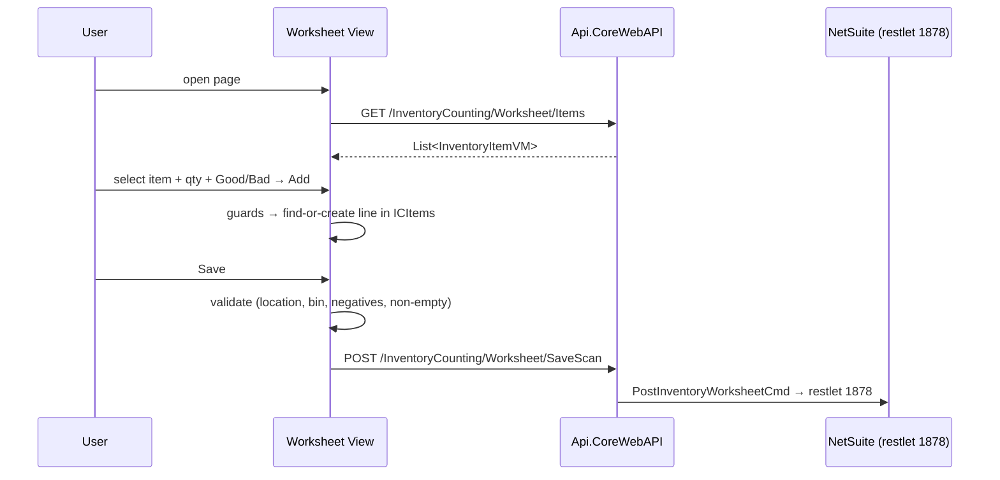

# Design — Mobile Inventory Worksheet Manual Input

**Date:** 2026-10-14
**Status:** Confirmed
**Mode:** FEATURE
**Scope:** `Mobile.MAUI` — manual item entry on the Inventory Worksheet page
**Related:** requirements.md (sibling)

## Decision record

**Problem:** Mobile worksheet can only record quantities via barcode scan; unreadable/missing barcodes block counting.

**Decisions:**

1. **Reuse `ICItems` as the single line store** — manual entries are `InventoryWorksheetLineVM` instances created/updated by the same logic shape as `ProcessScannedItem`.
   - *Rationale:* zero backend change; payload builder already merges Good/Bad + bin into NetSuite details.
   - *Trade-off:* manual entries inherit single-bin-per-session (confirmed acceptable by business).
2. **Reuse the Good/Bad toggle (`NextScanIsBad`)** for manual entries instead of a separate manual-mode selector.
   - *Rationale:* one mental model, less state.
3. **Load item list on first render** via the existing (currently commented) `ActionGetInventoryItems` → `GET /InventoryCounting/Worksheet/Items`.
   - *Rationale:* list is not location-scoped; loading once avoids repeated calls.
4. **Location change clears lines with confirmation** (Req 4.1) — web parity; prevents silent quantity carry-over into a new bin context.

**Trade-off accepted:** manual quantity is free-text decimal (numeric keyboard) rather than a stepper — faster for bulk counts, matches scan-flow ergonomics.

**Deferred by decision:** automated unit tests for the extracted line logic (extract-helper + `Mobile.MAUI.Tests` xUnit project). Manual verification matrix is the verification strategy for this change.

## What already exists (verified)

| Plumbing | Location |
|---|---|
| Mobile page + code-behind | `Mobile.MAUI/Components/Pages/InventoryCounting/InventoryWorksheet/CreateInventoryWorksheetView.razor(.cs)` |
| Scan-actions panel (add manual action here) | `.razor:209-326` |
| Line creation/update pattern to mirror | `.razor.cs:405-439` (`ProcessScannedItem`) |
| Good/Bad toggle state | `.razor.cs:706-751` (`ScanState` / `NextScanIsBad`) |
| Bin context + guards | `.razor.cs:48-54`, `SaveScan` guards `442-460` |
| Commented item-list action to restore | `.razor.cs:124-140`, `220-223` |
| API endpoint (no change) | `Api.CoreWebAPI/Controllers/InventoryCounting/InventoryCountingController.cs:47-63` |
| Payload builder (no change) | `Application.DataTransferObjects/Transactions/InventoryCounting/NS/Payload/PostInventoryWorksheetPayloadDTO.cs:51-114` |
| Web validation reference (read-only parity source) | `Web.BlazorServer/Components/Pages/Transaction/InventoryCounting/InventoryWorksheetPage.razor.cs:295-351` |

**What changes:** only `CreateInventoryWorksheetView.razor` + `.razor.cs`. **What does not:** API, DTOs, payload builder, web page, commented blocks (preserved per Req P4).

## Overview, technologies, principles

- **Technologies (verified):** .NET 8 MAUI Blazor Hybrid, Radzen Blazor components, existing `AppAction` / `ActionFactory` pattern, `Client` HTTP service, `Toast` helpers, `SecureStorage` for auth context.
- **Principles:** thin code-behind following the file's existing patterns; no new abstractions; manual entries and scans share one line store and one save path.

## Components

1. **Item list loader** — restore `ActionGetInventoryItems` (AppAction pattern, `.razor.cs:124-140`) and its first-render execution; populate `Data`.
2. **Manual-add panel** — new action item in the scan-actions panel: searchable `RadzenDropDown` over `Data` (`TextProperty=MaterialName`, value = `NetsuiteMaterialInternalId`, `AllowFiltering=true`), numeric quantity entry, Add button calling `AddManualItem()`.
3. **`AddManualItem()`** — guards (Req 2.1–2.3) → find-or-create line in `CurrentBinInternalId` → apply quantity to Good/Bad per `NextScanIsBad` → `ScanCount++` → clear inputs → `StateHasChanged`.
4. **Location-change confirmation** — extend `OnLocationChanged` (`.razor.cs:604-627`): if `ICItems` non-empty, show confirm dialog; on cancel, revert `SelectedLocationInternalId`; on confirm, clear `ICItems` + bins.
5. **Save validation** — add negative-quantity check to `SaveScan` (Req 3.1).

## Flow

## Correctness properties (testable)

- **CP1** (1.3, 1.4): Adding quantity for an item already in `ICItems` under the current bin context increments that line; no duplicate line is created.
- **CP2** (1.3): A manual entry with no existing line creates one with `NetsuiteBinInternalId == CurrentBinInternalId` and quantity applied to Good or Bad per `NextScanIsBad`.
- **CP3** (2.1–2.3): Manual entry with missing location, missing required bin, or invalid item/quantity leaves `ICItems` unchanged.
- **CP4** (3.1): Save with any negative Good/Bad quantity is rejected client-side; no HTTP call is made.
- **CP5** (4.1): Changing location with non-empty `ICItems` and cancelling leaves location and lines unchanged.
- **CP6** (4.1): Confirming a location change clears `ICItems` and bins.
- **CP7** (P2): Saved payload shape is unchanged — manual-only, scan-only, and mixed sessions all serialize to the same `SaveInventoryWorksheetRequestDTO` contract.
- **CP8** (P1): Existing scan handlers (`ProcessScannedItem`, `MoveScan`, `NegateScannedItem`) are unmodified.

## Error handling

- Client-side guards produce toasts (existing `Toast.Warning` pattern); no silent failures.
- Item-list load failure surfaces via the existing `AppAction` error path (toast); page remains usable for scanning.
- Save errors already handled by `ActionSaveScan.OnSuccess` (`result.Success` check, `.razor.cs:186-196`) — unchanged.

## Testing strategy

- **Unit:** none — no mobile test project exists; automated tests are explicitly deferred (see Decision record). `Integration.NS.Tests` fakes throw `NotSupportedException` for worksheet posting and are out of scope.
- **Manual/UI verification matrix (primary):** each CP1–CP7 exercised on device/emulator: manual add new item, manual add to existing scanned line, all three guards, negative-quantity save rejection, location-change cancel/confirm, mixed scan+manual save posting correct NetSuite payload (verify via API logs or NetSuite).
- **Regression:** scan-only session end-to-end (P1), no-bin location session (P3).

**Property-based testing assessment: NOT APPLICABLE** — no test project exists for the mobile client, and the logic under test is thin UI state mutation; introducing a test project is deferred by decision.

## Accepted consequences

- Manual quantities bypass barcode verification — item identity relies on user selection from the master list (mitigated by searchable dropdown showing code + name).
- `ScanCount` semantics now include manual entries (used only for display; no payload impact).

## Verification checklist

- [ ] Item list loads on first render
- [ ] CP1–CP8 verified per matrix above
- [ ] Commented blocks untouched (P4)
- [ ] `dotnet build` passes with only `Mobile.MAUI` changes
