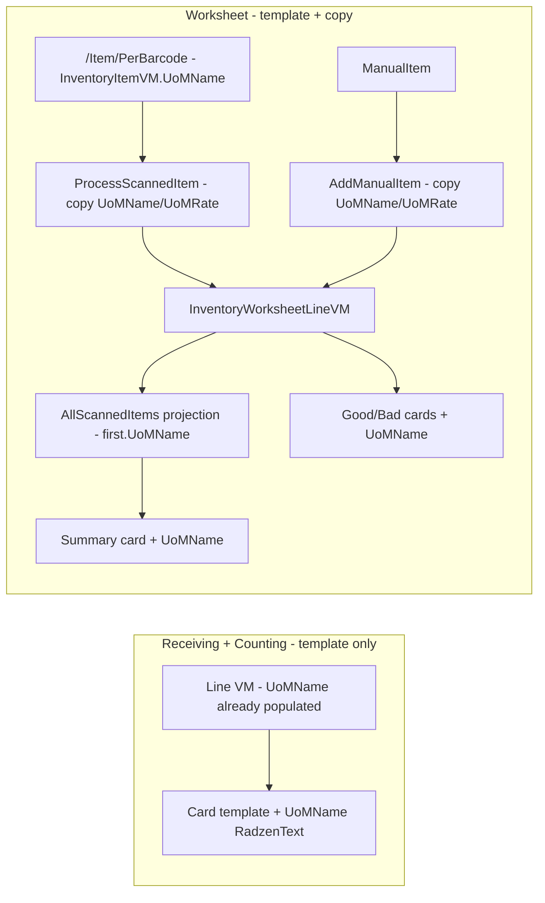

# Design — Mobile Packaging UoM on Item Cards (Receiving, Counting, Worksheet)

**Date:** 2026-10-14
**Status:** Confirmed
**Mode:** FEATURE
**Scope:** `Mobile.MAUI` item-card templates under `Components/Pages/Receiving/**` and `Components/Pages/InventoryCounting/**` + Mobile-only plumbing in `CreateInventoryWorksheetView.razor.cs`. No Web, API, DTO, SQL, or NetSuite changes.
**Related:** `2026-10-14-mobile-inventory-worksheet-manual-input` (same worksheet file — display-only additions, behaviors preserved), `2026-10-08-mobile-po-item-receipt-line-selection` (same PO file — posting path untouched).

## Findings (repository evidence)

1. **Stack/target:** `Mobile.MAUI` is a Blazor Hybrid app — `.razor` markup + partial-class `.razor.cs` code-behind; line data comes from `Shared.Libraries` VMs. No backend, MediatR, Mapster, or SQL work is needed.
2. **Local pattern:** Packing cards render `<RadzenText Text="@row.UoMName" TextStyle="TextStyle.Subtitle2" Style="font-size:.6rem" />` as one line in the card info stack — the change is replicating that exact line per card template.
3. **Data already flows:** `UoMName` is populated at load for every Receiving/Counting line VM (PO `.razor.cs:117,159`; Receiving TO `:91,129`; TO×IF `:116,154`; Returns×IF `:105,534,585`; Counting `:75,102,351`), and is already consumed by search filters and Last-Scanned banners. Only the Worksheet scan-copy path drops it.
4. **Discrepancy noted, not fixed:** `TransactionVM` re-declares `UoMName` (line 34) shadowing `InventoryItemVM`'s (line 16). Display binding is unaffected; per the architectural-debts rule it stays out of scope.
5. **Verification surface:** there is no mobile UI test project; prior mobile specs verify via build + on-device check. Same applies here.

## Decision record

| # | Problem | Decision | Rationale / trade-off |
|---|---|---|---|
| D1 | Packing TO Bad tab (`:121-124`) lacks `UoMName` while Good/BackOrdered siblings have it | Include the +1 line (confirmed) | It's the stated reference; leaving it inconsistent undermines "like in packing". Cost: one line, zero risk. |
| D2 | Worksheet summary groups by material across bins; UoM must come from somewhere | Project first-seen `UoMName` (confirmed) | Multi-UoM same-material scans are an edge case; grouping by material+UoM would change summary identity and save-adjacent behavior. Cross-bin nuance: summary groups by material only while lines are keyed material+bin, so first bin's UoM wins — accepted. |
| D3 | Where to place the UoM line on Receiving cards | After the last existing info line (weight/vendor/location) | Keeps each screen's field order stable; still satisfies Packing's Material → context → UoM ordering. |
| D4 | Empty `UoMName` (non-inventory/manual items) | Render as-is, like Packing | No conditional markup; consistent with reference. An empty `.6rem` line is visually negligible. |

## What already exists (verified)

**Reference (Packing, read-only except D1):**
- `Mobile.MAUI/Components/Pages/Packing/TransferOrder/TransferOrderItemView.razor` — Good `:92`, BackOrdered `:157` ✅; Bad `:121-124` ❌ (D1 fix)
- `Mobile.MAUI/Components/Pages/Packing/Returns/ReturnsItemView.razor` — `:79`, `:113` ✅
- `Mobile.MAUI/Components/Pages/Packing/VendorReturnAuthorization/VendorReturnAuthorizationItemView.razor` — `:92`, `:124` ✅

**Receiving cards needing +1 line each (data already in VM):**
- `Receiving/PurchaseOrder/PurchaseOrderItemView.razor` — Good `:113-127`, Bad `:179-193`
- `Receiving/TransferOrder/TransferOrderItemView.razor` — Good `:55-59`, Bad `:86-90`
- `Receiving/TransferOrder/TOxItemFulfillmentItemView.razor` — Good `:89-93`, Bad `:120-124`
- `Receiving/Returns/TOxReturnxItemFulfillmentItemView.razor` — single card `:84-88`

**Already compliant (no change):** `Receiving/Returns/ReturnsItemView.razor:56`; `InventoryCounting/InventoryCountingItemView.razor:27,56`.

**Worksheet (template + plumbing):**
- `InventoryCounting/InventoryWorksheet/CreateInventoryWorksheetView.razor` — summary `:80-96`, Good `:129-149`, Bad `:171-191`
- Same file's `.razor.cs` — `ProcessScannedItem` builds `InventoryWorksheetLineVM` without `UoMName` (`:457-464`), as does `AddManualItem` for manual entries (`:508-515`); source `InventoryItemVM` carries it (`Shared.Libraries/ViewModel/Common/InventoryItemVM.cs:16`, fed by `/Item/PerBarcode` ← `NS_Item_Get_PerBarcode.sql:8`)
- `ScannedItemSummaryVM` (`:880-888`) lacks `UoMName`; projection `AllScannedItems` (`:78-84`) must populate it
- `SaveScan` posts `ICItems` directly (`:207-212`); `InventoryWorksheetLineVM : InventoryItemVM` means `UoMName`/`UoMRate` are already serialized today as `""`/`0` — populating them changes values, not shape; backend confirmation required (see C5)
- Note: `TransactionVM.UoMRate` is `decimal` while `InventoryItemVM.UoMRate` is `int` — different classes, no conflict; worksheet copies use the `int` (also the value the quantity math already reads at `:469`)

**What changes:** 6 `.razor` templates (11 inserted lines total) + 5 C# lines in one `.razor.cs`. **What does not:** Web, API, DTOs, Mapster, SQL/SuiteQL, NetSuite, payloads, quantity math, search, tabs, save flows.

## Overview & data flow

Display-only: each card binds an already-populated `row.UoMName`. Only the Worksheet needs upstream copies (scan and manual entry → line → summary).

## Design principles

- Exact Packing markup reuse (`Subtitle2 / .6rem`) — zero new styling.
- No new abstractions, no shared component extraction (11 insertions don't justify one; matches repo's per-screen template duplication).
- Commented code untouched (P3); debts untouched.

## Correctness properties

- **C1 → 1.1, 1.2:** Every template listed in "Receiving cards" + Worksheet + D1 contains a `row.UoMName` `RadzenText`. *Check: grep + on-device Good/Bad tabs.*
- **C2 → 1.3:** UoM line sits after the last existing info line in each card. *Check: visual.*
- **C3 → 2.2, 2.3:** After scanning or manual entry, `ICItems` line carries the source item's `UoMName`/`UoMRate`. *Check: scan → and manual-entry → Good/Bad card shows UoM.*
- **C4 → 2.4:** `AllScannedItems` summary carries first-seen `UoMName`; summary card renders it. *Check: scan → toggle All view.*
- **C5 → 2.5, 3.3, P1, P2:** Save payload **shape** unchanged (fields were already serialized as `""`/`0`; values now populate). Quantity math, search, tab filters unchanged. The `/InventoryCounting/Worksheet/SaveScan` backend is confirmed to ignore `UoMName`/`UoMRate` (code-read only; no backend change). *Check: diff review + existing save flow on-device.*
- **C6 → 3.2:** No file outside `Mobile.MAUI/Components/Pages/{Receiving,InventoryCounting,Packing}/**` is modified. *Check: `git status`.*
- **C7:** `dotnet build` on the mobile-affected projects succeeds with zero errors.

## Error handling / user-visible behavior

None new. An empty `UoMName` renders a blank `.6rem` line exactly as Packing does today (D4). No toasts, guards, or validation change.

## Testing strategy

- **Unit/integration:** none — no mobile UI test project exists; change is markup binding plus 5 lines of property copies with no branching.
- **Regression:** on-device pass over PO / Receiving TO / TO×IF / Returns×IF (Good+Bad tabs), Worksheet (scan → Good/Bad cards → All summary → save), Counting (unchanged, spot-check), Packing TO Bad tab (D1).
- **PBT assessment: NOT APPLICABLE** — display-only binding of an existing string; no logic, invariants, or generators involved.

## Accepted consequences & out of scope

- Worksheet summary shows first-seen UoM per material (D2 edge case documented).
- Manual-entry lines get UoM display via the `AddManualItem` copy (C3) — no extra template work, but the manual-input spec's file will show adjacent diff lines.
- Out of scope: Trip Ticket (transaction-level cards, no line UoM), Last-Scanned banners, Web, backend changes (backend **confirmation** of field-ignorance is in scope as C5 verification), automated mobile tests, `TransactionVM`/`InventoryItemVM` shadowing cleanup.

## Requirement coverage audit (2026-10-14)

Requirement: "Packaging UoM visibility for all item cards in all transactions (like in packing) - Mobile". Every `Template Context="row"` in `Mobile.MAUI/Components/Pages/**` was enumerated (31 occurrences):

| Module | Item-card templates | Status |
|---|---|---|
| Packing TransferOrder | 3 (Good/Bad/BackOrdered) | Reference; Bad tab fixed by D1 |
| Packing Returns / VendorReturnAuthorization | 2 + 2 | Reference, compliant |
| Receiving PurchaseOrder / TransferOrder / TOxItemFulfillment | 2 + 2 + 2 | In scope (1.1–1.2) |
| Receiving Returns TOxReturnxItemFulfillment | 1 | In scope (1.1–1.2) |
| Receiving Returns / InventoryCounting | 1 + 2 | Already compliant (3.1) |
| InventoryWorksheet | 3 | In scope (2.1) |
| TripTicket CreateTripTicketView | 2 | Not item cards — transaction-level (OrderNumber + Doc Date); excluded |

No item card in any Mobile transaction is left without UoM visibility once this spec lands.

## Verification checklist

- [ ] C1–C4 visible on-device per screen/tab listed above (scan **and** manual-entry paths for C3)
- [ ] Save flow posts same shape; backend `/InventoryCounting/Worksheet/SaveScan` code-read confirms `UoMName`/`UoMRate` ignored (C5)
- [ ] `git status` shows only the 6 `.razor` + 1 `.razor.cs` files (C6)
- [ ] Build succeeds with zero errors (C7)

