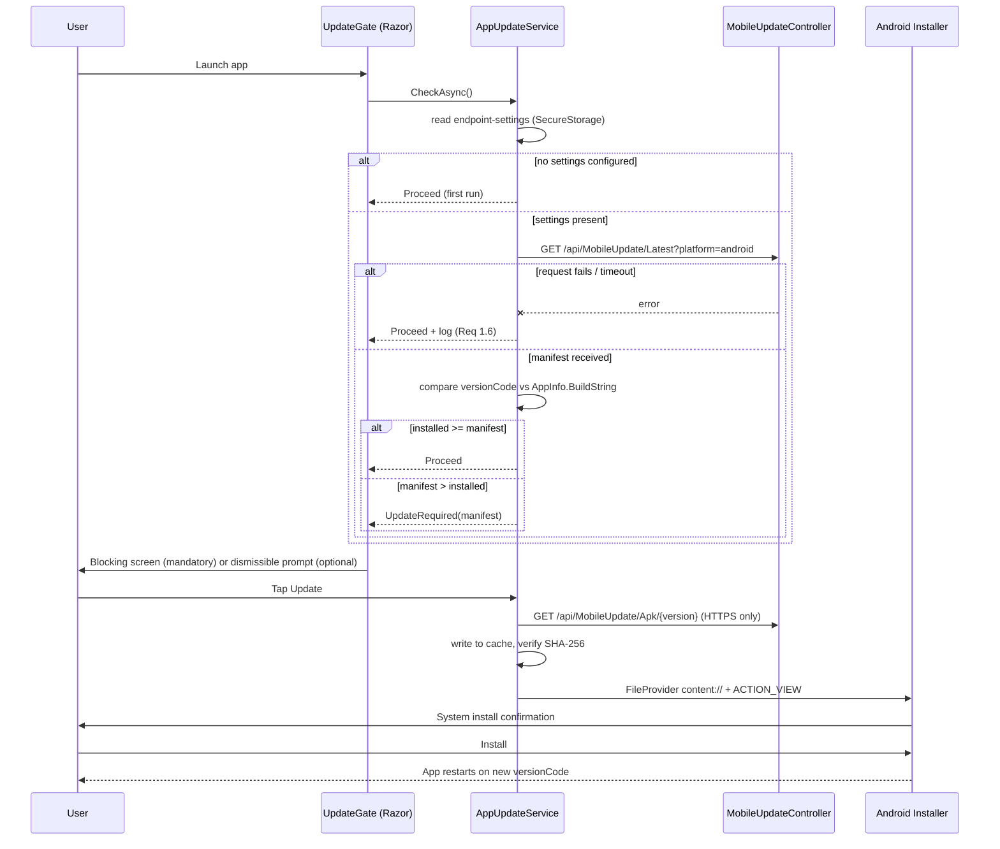

# Design — Android Over-The-Air APK Update

**Date:** 2026-10-19
**Status:** Confirmed
**Mode:** FEATURE
**Scope:** `Mobile.MAUI` (Android only) + `Api.CoreWebAPI`
**Related:** [requirements.md](requirements.md) (sibling)

## Decision record

**Problem:** Mobile changes can only reach client devices by manually building an APK and physically transferring it to a device that is often in use. There is no way to detect a stale build or enforce an update.

**Decisions:**

1. **Serve manifest and APK from `Api.CoreWebAPI`, not a separate IIS static folder.**
   - *Rationale:* one HTTPS surface, one deploy target, one place for headers. The static-`web.config` MIME approach works but adds a second thing to configure and secure.
   - *Trade-off:* APK traffic flows through the app's Kestrel/IIS pipeline; requires streaming and range support.

2. **The manifest is a JSON file on disk, path from configuration.**
   - *Rationale:* reverting a bad release means restoring an old file. No redeploy, no DB migration, no admin UI (Req 1.4, 2.7, 5.7).
   - *Trade-off:* manual file copy; no audit trail unless previous manifests are retained.

3. **Enforcement is a gate component above the Router, not a redirect.**
   - *Rationale:* a redirect can be navigated away from; a gate replaces the whole render tree. Nothing is reachable while blocked (Req 2.2).
   - *Trade-off:* the gate must own its own settings load and its own `HttpClient`.

4. **Version comparison uses the `versionCode` integer, never the display string.**
   - *Rationale:* `"1.10"` vs `"1.9"` breaks string comparison; Android itself compares the integer.
   - *Trade-off:* `ApplicationVersion` must be maintained honestly (Req 5.3).

5. **The update service uses its own `HttpClient`, not `ApiClientService`.**
   - *Rationale:* it must work before login and before `UpdateClient` is called; avoids coupling to the 401/404 throwing behavior.
   - *Trade-off:* a second HTTP path to maintain.

6. **Install hand-off uses a FileProvider `content://` URI with `Intent.ActionView`.**
   - *Rationale:* `file://` throws `FileUriExposedException` on API 24+; `ActionView` yields the standard system confirm dialog (Req 4.1, 4.5).
   - *Trade-off:* no silent install; the user taps Install.

7. **Pilot-first mandatory: publish `Mandatory: false`, verify on one device, then flip to `true`.**
   - *Rationale:* with a hard block and manual publishing, a bad APK locks the whole fleet. This costs zero code and eliminates that risk.
   - *Trade-off:* one extra manual step per release.

8. **SHA-256 is used for corruption detection only; trust comes from the APK signature.**
   - *Rationale:* an attacker controlling the manifest also controls the hash. Android rejects a differently-signed APK — that is the real boundary (Req 6.3).
   - *Trade-off:* no defense against a replayed, legitimately-signed older APK.

9. **No new test project.**
   - *Rationale:* only `Integration.NS.Tests` exists (`WMS.slnx:36-38`). Creating an API or MAUI test project is real scope. Pure logic is written to be testable; verification is scriptable HTTP checks plus a manual device matrix.
   - *Trade-off:* no automated regression net for this feature.

**Deferred by decision:** unit tests for version comparison and version-token validation (see Optional tasks).

## What already exists (verified)

| Plumbing | Location |
|---|---|
| Controller convention | `Api.CoreWebAPI/Controllers/Lookup/LookupController.cs:12-14`, `Controllers/Authentication/AuthController.cs:11-13` |
| Result envelope | `Shared.Libraries/Entities/ApiResult.cs:32-55` |
| Controller registration + PascalCase JSON | `Api.CoreWebAPI/Registers/WebApplicationService.cs:35-38` |
| DI extension point (API) | `Api.CoreWebAPI/Registers/CoreWebApiDI.cs:9-14` |
| DI extension point (mobile) | `Mobile.MAUI/Services/Extensions.cs:10-29` |
| Endpoint settings storage | `Mobile.MAUI/ViewModel/ClientEndpointVM.cs`, `Helpers/EndpointHelper.cs:8-15`, `Components/Pages/Administrator/EditEndpointDialog.razor.cs:25-38` |
| Secure storage convention | `SecureStorage.Get/SetAsync` across `Services/ApiClientService.cs:68`, `Services/JWTAuthStateProvider.cs:19` |
| Router root | `Mobile.MAUI/Components/Routes.razor:4-16`, `MainPage.xaml:9-13` |
| Android platform code precedent | `Mobile.MAUI/Platforms/Android/MainActivity.cs`, `Platforms/Android/Helper/ScanReceiver.cs` |
| App version | `Mobile.MAUI/Mobile.MAUI.csproj:31-32` |
| Target frameworks / min SDK | `Mobile.MAUI/Mobile.MAUI.csproj:4-5,39` |

**What changes:** new controller, manifest file, mobile service, gate component, Android permissions and FileProvider.
**What does not:** authentication, existing controllers, `ApiClientService`, `ClientEndpointVM`, scanner handling, routing behavior, `usesCleartextTraffic`.

## Overview



**Technologies (verified):** .NET 9, ASP.NET Core controllers with `ApiResult<T>`, MAUI Blazor Hybrid (Radzen), `SecureStorage`/`Preferences`, Android `PackageInstaller` hand-off via `Intent.ActionView`.

**Principles:** follow the existing controller and DI conventions; no new abstractions beyond what the feature needs; the update path never throws into startup; enforcement happens in exactly one place.

## Components

### API — `Api.CoreWebAPI/Controllers/Mobile/MobileUpdateController.cs` (new)

Follows the `LookupController` shape: `[ApiController]`, `[Route("api/[controller]")]`, `ApiResult<T>` returns. Both actions are explicitly `[AllowAnonymous]` even though authorization is currently unenforced (`ItemController.cs:16` and `UserController.cs:14` have `[Authorize]` commented out), so intent survives when auth is turned on.

- `GET api/MobileUpdate/Latest?platform=android`
  - Reads the manifest file at the configured path.
  - Returns `ApiResult<MobileUpdateVM>.Failed(...)` with a non-sensitive message if the file is missing, unreadable, or malformed — the client treats that as "check failed" and proceeds (Req 1.6).
  - Rewrites `ApkUrl` to an absolute URL built from the current request so the client never resolves paths itself.
  - Sets `Cache-Control: no-store, no-cache, must-revalidate` (Req 1.3).
- `GET api/MobileUpdate/Apk/{version}`
  - Validates `{version}` against a strict digits-and-dots pattern before touching the filesystem; rejects anything else with 400.
  - Resolves the filename inside the configured APK directory and verifies the resolved absolute path is still inside that directory (defeats traversal).
  - Returns 404 when absent.
  - `FileStreamResult` with `enableRangeProcessing: true`, content type `application/vnd.android.package-archive`.
  - Sets `Cache-Control: public, max-age=31536000, immutable` (the filename is versioned).

### API — `Application.DataTransferObjects/Mobile/MobileUpdateVM.cs` (new)

PascalCase property names to match `PropertyNamingPolicy = null` (`WebApplicationService.cs:37`):

```
Version (string), VersionCode (int), ApkUrl (string),
Sha256 (string), ReleaseNotes (string), Mandatory (bool)
```

### API — `Api.CoreWebAPI/MobileUpdate/manifest.json` (new, on disk)

```json
{
  "Version": "1.0.5",
  "VersionCode": 5,
  "ApkUrl": "https://host/api/MobileUpdate/Apk/1.0.5",
  "Sha256": "<64 hex chars>",
  "ReleaseNotes": "Bug fixes.",
  "Mandatory": false
}
```

Reverting a release = restoring the previous copy of this single file (Req 2.7).

Configuration keys (`appsettings.json`): `MobileUpdate:ManifestPath` (default `MobileUpdate/manifest.json`), `MobileUpdate:ApkDirectory` (default `MobileUpdate/apk`), resolved against the content root.

### Mobile — `Mobile.MAUI/Services/AppUpdateService.cs` (new)

Registered as a singleton in `Services/Extensions.cs` next to `ApiClientService` (`Extensions.cs:20`).

Responsibilities:

- Resolve the base URL from `endpoint-settings` via `EndpointHelper.BuildURI` — the same source `MainLayout.razor.cs:29-34` uses. **Resolved per check, not in the constructor**, because the user can change settings at runtime.
- `HttpClient` with a short timeout so startup cannot hang (P6).
- Numeric comparison of `int.Parse(AppInfo.Current.BuildString)` against `manifest.VersionCode`.
- Download to `FileSystem.CacheDirectory` with streaming progress and cancellation.
- SHA-256 comparison (Req 3.2, 3.3).
- Delegate installation to the Android partial.
- Record the outcome to `Preferences` (Req 7.1) — not `SecureStorage`, which is slower and reserved for secrets.

Result states: `NoSettings`, `UpToDate`, `Optional`, `Mandatory`, `CheckFailed`.

**Any exception returns `CheckFailed`; nothing propagates into startup** (Req 1.6, CP2).

### Mobile — `Mobile.MAUI/Platforms/Android/ApkInstaller.cs` (new)

Partial-class platform implementation so shared code stays platform-agnostic (Req 8.2).

1. `PackageManager.CanRequestPackageInstalls()` guarded by `Build.VERSION.SdkInt >= BuildVersionCodes.O`. Min SDK is 24 (`csproj:39`), so API 24–25 skip the per-app check and rely on the global setting.
2. If not permitted → launch `Settings.ActionManageUnknownAppSources` with the package URI, return a distinct result so the UI can explain (Req 4.3).
3. Otherwise `FileProvider.GetUriForFile` with the runtime package authority, then `Intent.ActionView` with `application/vnd.android.package-archive`, `GrantReadUriPermission`, `NewTask` (Req 4.1).
4. Never attempt silent installation (Req 4.5).

### Mobile — `Mobile.MAUI/Components/UpdateGate.razor` + `.razor.cs` (new)

Wraps the router inside the root component. States: `Checking`, `Ready`, `Blocked`, `Downloading`, `Failed`.

- `Ready` renders `<Routes />` unchanged.
- `Blocked` shows installed version, target version, release notes, an Update button, and escalation guidance (Req 7.3). Dismissible only when `Optional` (Req 2.3); non-dismissible when `Mandatory` (Req 2.2).
- `Downloading` shows progress and Cancel (Req 3.4).
- `Failed` shows the reason and Retry; stays blocked when mandatory (Req 7.2).

The check runs only on gate initialization — no timers, no connectivity subscription — so navigation and reconnection never trigger a mid-session block (Req 2.5).

### Android — `Mobile.MAUI/Platforms/Android/AndroidManifest.xml`

- Add `<uses-permission android:name="android.permission.REQUEST_INSTALL_PACKAGES" />` beside the existing permissions (lines 12-14).
- Add a `<provider>` inside `<application>` (lines 3-11) with `android:authorities="<runtime package>.fileprovider"`, `android:exported="false"`, `android:grantUriPermissions="true"`, and meta-data `android.support.FILE_PROVIDER_PATHS` → `@xml/file_paths`.
- Leave `usesCleartextTraffic` untouched; the service enforces HTTPS itself (Req 3.5).

### Android — `Mobile.MAUI/Platforms/Android/Resources/xml/file_paths.xml` (new)

The `xml` resource directory does not exist yet. Expose only `<cache-path name="updates" path="." />` — nothing broader.

**Known discrepancy:** `AndroidManifest.xml:2` declares `package="com.wmsmobile.appname"` while `csproj:28` sets `ApplicationId` to `com.WMS.mobile.maui`. The runtime package name must be confirmed on a device before choosing the FileProvider authority and the unknown-sources settings intent. This is a pre-existing condition and is not changed by this feature.

## Correctness properties

| # | Property | Requirements |
|---|---|---|
| CP1 | For any installed `versionCode` I and manifest M: the app blocks iff `M > I && M.Mandatory`. Equality and lower values never block and never downgrade. | 2.1, 2.2, 2.3, 2.4 |
| CP2 | For any network failure, timeout, malformed manifest, or missing manifest file, the app reaches `Ready` and never `Blocked`. | 1.6, 2.2, P6 |
| CP3 | With no `endpoint-settings` stored, the app reaches `Ready` without any network call. | 1.5, P2 |
| CP4 | A downloaded file whose SHA-256 differs from the manifest is deleted and installation is never offered. | 3.2, 3.3 |
| CP5 | An `ApkUrl` with a non-HTTPS scheme is rejected before any download begins. | 3.5 |
| CP6 | Once `Blocked`, no route renders and no WMS action is reachable until the app restarts on a version satisfying CP1. | 2.2, 2.5 |
| CP7 | The `Apk/{version}` action never serves a file outside the configured APK directory for any version token. | 5.2, 6.2 |
| CP8 | Reverting `manifest.json` to a lower `versionCode` causes devices already on the newer build to stop blocking on next start. | 2.7 |

## Error handling and user-visible behavior

| Condition | Behavior |
|---|---|
| Manifest missing or malformed | API returns `Failed`; client logs and proceeds (Req 1.6) |
| APK missing on server | 404; UI shows "update unavailable, try again"; stays blocked when mandatory, re-checkable |
| Hash mismatch | File deleted; UI shows retry; installation never offered (Req 3.3) |
| Unknown-sources disabled | Settings deep-link plus explanation (Req 4.3) |
| User cancels system installer | Returns to `Blocked`; update still pending (Req 4.4) |
| Download interrupted or cancelled | Partial file discarded; no state corruption (Req 3.6) |
| No endpoint settings | No network call; normal startup (CP3) |

## Testing

**Reality check:** there is no API or MAUI test project (`WMS.slnx:36-38`). Creating one is optional scope, not assumed.

**Scriptable HTTP verification (no device):**

```
curl -i https://<host>/api/MobileUpdate/Latest
curl -i -o apk.bin https://<host>/api/MobileUpdate/Apk/1.0.5
(Get-FileHash apk.bin -Algorithm SHA256).Hash.ToLowerInvariant()
curl -i https://<host>/api/MobileUpdate/Apk/..%2f..%2fappsettings.json
```

Assert: `no-store` present on `Latest`; PascalCase JSON shape; served APK hash equals the manifest; traversal returns 400; unknown version returns 404.

**Manual device matrix (the only way to verify installation):**

1. Fresh device with no settings → normal startup (CP3).
2. Up-to-date device → no prompt (CP1 equality).
3. Optional update → Later dismisses; app usable.
4. Mandatory update → non-dismissible block; no route reachable (CP6).
5. Unknown-sources disabled → settings screen opens (Req 4.3).
6. User declines system installer → gate stays blocked (Req 4.4).
7. Airplane mode at launch → normal startup (CP2).
8. Doctored `Sha256` → installation never offered; no file left in cache (CP4).
9. Non-HTTPS `ApkUrl` → download refused (CP5).
10. Manifest reverted to a lower `versionCode` → device on the newer build unblocks (CP8).

**Extracted pure logic** (version comparison, manifest validation, hash comparison, version-token path validation) is written so it can be unit-tested later without a device.

**Property-based testing: NOT APPLICABLE.** The behaviors are I/O-bound (HTTP, filesystem, Android installer) or trivially enumerable. CP1 is the only candidate and is fully covered by a small boundary table (`I<M`, `I=M`, `I>M` × `Mandatory` true/false), which is cheaper and clearer than a generator.

## Accepted consequences

- Hard block plus manual publishing means a bad release can lock the fleet. Mitigated by the pilot-first decision, manifest revert (Req 2.7), and the pre-publish check (Req 5.6) — not eliminated.
- No automated regression tests for this feature.
- No audit trail of who published what, or when.
- iOS, MacCatalyst, and Windows receive nothing (Req 8.1, 8.2).
- Two HTTP paths exist in the mobile app.
- The API's pre-existing authorization gap is not addressed here.
- The `package` vs `ApplicationId` discrepancy remains; the feature works around it rather than fixing it.

## Out of scope

Unchanged from requirements, plus: adding a test project, a publishing admin UI, release-history retention, code-signing or notarization work, and any MDM or device-owner provisioning.

## Verification checklist

- [ ] `Latest` returns PascalCase JSON with `no-store` and is reachable without a token.
- [ ] `Apk/{version}` streams with range support and 404s for unknown versions.
- [ ] Path-traversal attempts on `{version}` are rejected.
- [ ] Gate renders `Ready` with no settings and with the server offline.
- [ ] Gate blocks only when `VersionCode > installed && Mandatory`.
- [ ] Hash mismatch blocks installation.
- [ ] Non-HTTPS `ApkUrl` is refused.
- [ ] Unknown-sources deep link opens the correct screen on API 26+.
- [ ] API 24–25 devices install without the per-app gate.
- [ ] Reverting the manifest unblocks devices on the newer build.
- [ ] Existing login, scanner, and API routes behave identically.
