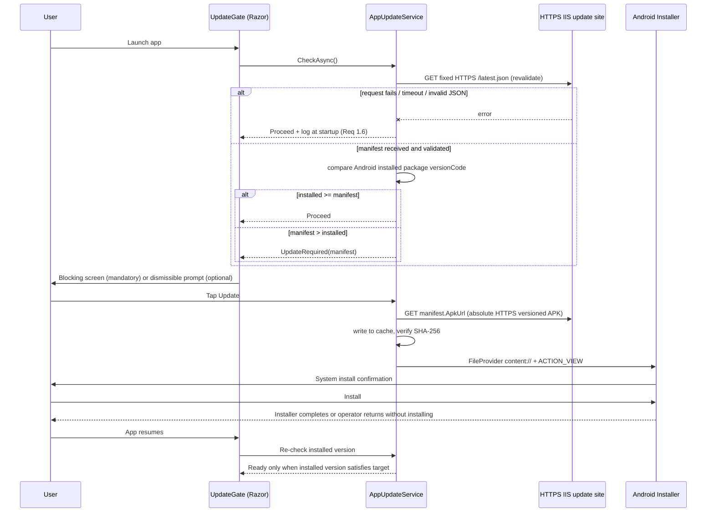

# Design — Android Over-The-Air APK Update

**Date:** 2026-10-19
**Status:** Confirmed
**Mode:** FEATURE
**Scope:** `Mobile.MAUI` (Android only) + static release hosting on the client IIS server
**Related:** [requirements.md](requirements.md) (sibling)

> **Review revision (2026-10-28):** Updated at the user's request to use a fixed IIS-hosted manifest and APK. Mobile-only release publication is independent of API deployment.

## Decision record

**Problem:** Mobile changes can only reach client devices by manually building an APK and physically transferring it to a device that is often in use. There is no way to detect a stale build or enforce an update.

**Decisions:**

1. **Serve manifest and APK as static files from a dedicated HTTPS IIS update site, independently of `Api.CoreWebAPI`.**
   - *Rationale:* mobile-only releases require no API rebuild or deployment; IIS handles large static APK downloads without routing them through the API application.
   - *Trade-off:* IIS HTTPS certificate, static MIME type, file ACL, cache policy, and staging/production paths must be configured and verified.

2. **The manifest is a JSON file (`latest.json`) at a fixed HTTPS IIS URL; it points to a versioned APK on the same site.**
   - *Rationale:* publishing/rolling back a release is replacing a small file; neither action requires API deployment or a database/admin UI (Req 1.4, 2.7, 5.7).
   - *Trade-off:* manual file publication; preserve previous manifests and APKs for rollback/audit. The manifest must be served with revalidation/no-cache semantics; versioned APKs can be immutable cached.

3. **Enforcement is a gate component around the Router's render content, not a redirect or recursive Routes render.**
   - *Rationale:* a redirect can be navigated away from; the gate renders its child Router only when ready and renders no route content while blocked (Req 2.2). `UpdateGate` accepts `ChildContent`; it must not render `<Routes />` from inside `Routes.razor`, which would recurse.
   - *Trade-off:* the gate must own endpoint initialization/checking and its own `HttpClient`.

4. **Version comparison uses the `versionCode` integer, never the display string.**
   - *Rationale:* `"1.10"` vs `"1.9"` breaks string comparison; Android itself compares the integer.
   - *Trade-off:* `ApplicationVersion` must be maintained honestly (Req 5.3).

5. **The update service uses its own `HttpClient`, not `ApiClientService`.**
   - *Rationale:* it must work before login and before `UpdateClient` is called; avoids coupling to the 401/404 throwing behavior.
   - *Trade-off:* a second HTTP path to maintain.

6. **Install hand-off uses a FileProvider `content://` URI with `Intent.ActionView`.**
   - *Rationale:* `file://` throws `FileUriExposedException` on API 24+; `ActionView` yields the standard system confirm dialog (Req 4.1, 4.5).
   - *Trade-off:* no silent install; the user taps Install.

7. **Pilot-first mandatory: publish `Mandatory: false`, verify on one device, then flip to `true`.**
   - *Rationale:* with a hard block and manual publishing, a bad APK locks the whole fleet. This costs zero code and eliminates that risk.
   - *Trade-off:* one extra manual step per release.

8. **SHA-256 is used for corruption detection only; trust comes from the APK signature.**
   - *Rationale:* an attacker controlling the manifest also controls the hash. Android rejects a differently-signed APK — that is the real boundary (Req 6.3).
   - *Trade-off:* no defense against a replayed, legitimately-signed older APK.

9. **No new test project.**
   - *Rationale:* no MAUI test project exists (`WMS.slnx:36-38`). Creating one is real scope. Pure logic is written to be testable; verification is scriptable IIS checks plus a manual device matrix.
   - *Trade-off:* no automated regression net for this feature.

**Deferred by decision:** unit tests for version comparison and version-token validation (see Optional tasks).

10. **Initialize endpoint resolution independently of layout rendering.**
    - *Rationale:* current `CleanLayout.razor` seeds `endpoint-settings` from `EndpointDefaults.Polaris`, but OTA checks use a fixed IIS URL and do not rely on routed layout initialization.
    - *Trade-off:* the fixed update URL must be set in build/deployment configuration independently of operational endpoint settings.

11. **Use one fixed HTTPS update-site URL for both manifest and APK, independent of the configured operational API endpoint.**
    - *Rationale:* current Polaris API endpoint is HTTP/private-network and serves WMS operations. Separating update hosting prevents endpoint edits and API deployments from controlling mobile release discovery and protects both manifest and APK transport.
    - *Trade-off:* the client IIS update hostname and valid certificate must be provisioned and reachable from all target devices; stage and production URLs must be configured deliberately.

12. **Recover installed bad builds by forward-fixing, not manifest rollback.**
    - *Rationale:* Android installation is not an in-app downgrade mechanism. Lowering the manifest target may unblock devices, but does not replace an APK already installed.
    - *Trade-off:* recovery consumes a higher monotonically increasing `versionCode` and requires the same signing key.

## What already exists (verified)

| Plumbing | Location |
|---|---|
| DI extension point (mobile) | `Mobile.MAUI/Services/Extensions.cs:10-29` |
| Endpoint settings storage | `Mobile.MAUI/ViewModel/ClientEndpointVM.cs`, `Helpers/EndpointHelper.cs:8-15`, `Components/Pages/Administrator/EditEndpointDialog.razor.cs:25-38` |
| Default API endpoint | `Mobile.MAUI/Helpers/EndpointDefaults.cs:5-17`; Polaris currently resolves to `http://192.168.5.27:8768/api` |
| Default endpoint initialization | `Mobile.MAUI/Components/Layout/CleanLayout/CleanLayout.razor:13-30` persists that default when storage is empty; this layout side effect cannot be assumed to run before a root-level gate |
| Secure storage convention | `SecureStorage.Get/SetAsync` across `Services/ApiClientService.cs:68`, `Services/JWTAuthStateProvider.cs:19` |
| Router root | `Mobile.MAUI/Components/Routes.razor:4-16`, `MainPage.xaml:9-13` |
| Android platform code precedent | `Mobile.MAUI/Platforms/Android/MainActivity.cs`, `Platforms/Android/Helper/ScanReceiver.cs` |
| App version | `Mobile.MAUI/Mobile.MAUI.csproj:31-32` |
| Target frameworks / min SDK | `Mobile.MAUI/Mobile.MAUI.csproj:4-5,39` |
| API auth and routing pipeline | `Api.CoreWebAPI/Program.cs:13-29,46-53`; no changes to this pipeline are needed for OTA updates. |
| Recent operational behavior to preserve | Recent mobile/API work includes scan-first transaction selection and fresh quantity revalidation; updater changes must not alter these workflows or existing request/auth paths. |

**What changes:** mobile updater service, gate component, Android permissions/FileProvider, and a documented IIS static-site release procedure. The IIS site serves `latest.json` and versioned APKs.
**What does not:** `Api.CoreWebAPI`, its authentication/controllers, `ApiClientService`, `ClientEndpointVM`, scanner handling, routing behavior, `usesCleartextTraffic`, or operational API endpoint configuration.

## Overview



**Technologies (verified):** .NET 9, MAUI Blazor Hybrid (Radzen), `Preferences`, Android package installer hand-off via `Intent.ActionView`, and IIS static HTTPS hosting.

**Principles:** follow the existing controller and DI conventions; no new abstractions beyond what the feature needs; the update path never throws into startup; enforcement happens in exactly one place; endpoint resolution is independent of route-layout side effects.

## Components

### IIS — Static update site contract (deployment, not an API project)

- Fixed manifest URL is supplied through a mobile build/deployment setting, e.g. `https://updates.client.example.com/android/latest.json`. It is independent of `endpoint-settings` and cannot be changed by the operational API endpoint dialog.
- `latest.json` is plain JSON (not wrapped in `ApiResult<T>`), served with `Cache-Control: no-store, no-cache, must-revalidate` (and equivalent IIS/proxy rules); clients also request revalidation.
- IIS serves only intended read-only release files. Configure `.apk` MIME type as `application/vnd.android.package-archive`, valid trusted HTTPS, and appropriate read ACLs. Do not enable directory browsing.
- Store immutable versioned APK files under a stable path; retain prior versions for rollback. The APK filename and manifest `ApkUrl` are published together.

### Shared contract — `latest.json`

```json
{
  "Version": "1.0.5",
  "VersionCode": 5,
  "ApkUrl": "https://updates.client.example.com/android/apk/1.0.5.apk",
  "Sha256": "<64 hex chars>",
  "ReleaseNotes": "Bug fixes.",
  "Mandatory": false
}
```

The manifest's `VersionCode` MUST equal the Android version code embedded in the APK; `Sha256` MUST match that exact file. Manifest rollback means replacing `latest.json` with a previous valid document; it does not downgrade installed APKs. Repair installed bad builds with a corrected higher-version APK signed by the same release key.

### Mobile — `Mobile.MAUI/Services/AppUpdateService.cs` (new)

Registered as a singleton in `Services/Extensions.cs` next to `ApiClientService` (`Extensions.cs:20`).

Responsibilities:

- Fetch `latest.json` from the fixed HTTPS update URL supplied as non-secret mobile build/deployment configuration. Do not derive it from `endpoint-settings`, `EndpointDefaults.Polaris`, incoming HTTP request data, or the operational API base URL.
- Require HTTPS for manifest and APK, normal trusted-certificate validation, and no redirect from HTTPS to HTTP. The manifest's APK URL must be absolute and point to the intended versioned file.
- `HttpClient` with a short timeout so startup cannot hang (P6).
- Numeric comparison of installed Android build/version code against `manifest.VersionCode`. MAUI documents Android `AppInfo.Current.BuildString` as the manifest `android:versionCode`; parse safely and verify against a built APK on a pilot device. Display version remains cosmetic.
- Download to `FileSystem.CacheDirectory` with streaming progress and cancellation.
- SHA-256 comparison (Req 3.2, 3.3).
- Delegate installation to the Android partial.
- Record the outcome to `Preferences` (Req 7.1) — not `SecureStorage`, which is slower and reserved for secrets.

Result states: `UpToDate`, `Optional`, `Mandatory`, `CheckFailed`. The update URL is fixed configuration and independent of operational endpoint settings.

**Any exception or invalid manifest returns `CheckFailed`; nothing propagates into startup** (Req 1.6, CP2). A failed startup check follows fail-open policy. A failed recheck while an already-active mandatory gate is retained keeps that gate active and offers retry.

### Mobile — `Mobile.MAUI/Platforms/Android/ApkInstaller.cs` (new)

Partial-class platform implementation so shared code stays platform-agnostic (Req 8.2).

1. `PackageManager.CanRequestPackageInstalls()` guarded by `Build.VERSION.SdkInt >= BuildVersionCodes.O`. Min SDK is 24 (`csproj:39`), so API 24–25 skip the per-app check and rely on the global setting.
2. If not permitted → launch `Settings.ActionManageUnknownAppSources` with the package URI, return a distinct result so the UI can explain (Req 4.3).
3. Otherwise `FileProvider.GetUriForFile` with the runtime package authority, then `Intent.ActionView` with `application/vnd.android.package-archive`, `GrantReadUriPermission`, `NewTask` (Req 4.1).
4. Never attempt silent installation (Req 4.5).
5. Do not assume the `ACTION_VIEW` launch returns a dependable accepted/declined result. When the app resumes, re-read the installed version and re-run the manifest check; remain blocked if the mandatory target is still newer.

### Mobile — `Mobile.MAUI/Components/UpdateGate.razor` + `.razor.cs` (new)

Wraps the router inside the root component. States: `Checking`, `Ready`, `Blocked`, `Downloading`, `Failed`.

- The gate accepts a `RenderFragment ChildContent`; `Ready` renders that child content (the existing Router) unchanged. `Blocked` renders no route tree. It must not render `<Routes />` recursively from within `Routes.razor`.
- `Blocked` shows installed version, target version, release notes, an Update button, and escalation guidance (Req 7.3). Dismissible only when `Optional` (Req 2.3); non-dismissible when `Mandatory` (Req 2.2).
- `Downloading` shows progress and Cancel (Req 3.4).
- `Failed` shows the reason and Retry; stays blocked when mandatory (Req 7.2).

The check runs only on gate initialization — no timers, no connectivity subscription — so navigation and reconnection never trigger a mid-session block (Req 2.5).

### Android — `Mobile.MAUI/Platforms/Android/AndroidManifest.xml`

- Add `<uses-permission android:name="android.permission.REQUEST_INSTALL_PACKAGES" />` beside the existing permissions (lines 12-14).
- Add a `<provider>` inside `<application>` (lines 3-11) with `android:authorities="<runtime package>.fileprovider"`, `android:exported="false"`, `android:grantUriPermissions="true"`, and meta-data `android.support.FILE_PROVIDER_PATHS` → `@xml/file_paths`.
- Leave `usesCleartextTraffic` untouched; the service enforces HTTPS itself (Req 3.5).

### Android — `Mobile.MAUI/Platforms/Android/Resources/xml/file_paths.xml` (new)

The `xml` resource directory does not exist yet. Expose only `<cache-path name="updates" path="." />` — nothing broader.

**Known discrepancy:** `AndroidManifest.xml:2` declares `package="com.wmsmobile.appname"` while `csproj:28` sets `ApplicationId` to `com.WMS.mobile.maui`. The runtime package name must be confirmed on a device before choosing the FileProvider authority and the unknown-sources settings intent. This is a pre-existing condition and is not changed by this feature.

## Correctness properties

| # | Property | Requirements |
|---|---|---|
| CP1 | For any installed `versionCode` I and manifest M: the app blocks iff `M > I && M.Mandatory`. Equality and lower values never block and never downgrade. | 2.1, 2.2, 2.3, 2.4 |
| CP2 | A failed startup check reaches `Ready`; a failed resume recheck while a mandatory gate is active retains the gate with retry available. | 1.6, 2.2, 4.4 |
| CP3 | The same fixed HTTPS manifest URL is used regardless of operational endpoint settings or Polaris defaults. | 1.5, 9.1 |
| CP4 | A downloaded file whose SHA-256 differs from the manifest is deleted and installation is never offered. | 3.2, 3.3 |
| CP5 | Manifest and `ApkUrl` must be HTTPS with trusted certificates; redirects may not downgrade either request to HTTP. | 3.5, 9.1, 9.2 |
| CP6 | Once `Blocked`, no route renders and no WMS action is reachable until a successful check confirms an installed version satisfying the target; after installer return/resume, the check determines whether the block remains. | 2.2, 2.5, 4.4 |
| CP7 | IIS serves only intended static release files and does not expose directory listings or API deployment output. | 6.1, 6.2 |
| CP8 | Reverting `manifest.json` to a lower `versionCode` removes the block only for devices whose installed version is at least that value; an installed bad build requires a higher-version repair APK. | 2.7, 5.3, 5.4 |

## Error handling and user-visible behavior

| Condition | Behavior |
|---|---|
| Manifest missing, malformed, or invalid | Client logs and proceeds on startup (Req 1.6); if mandatory gate is already active during installer-return recheck, retain gate and offer retry |
| No saved operational API endpoint | No effect on updater; fixed update-site URL is used |
| HTTPS failure or HTTPS-to-HTTP redirect | Reject the request; follow startup fail-open or active-gate retry policy |
| APK missing on server | 404; UI shows "update unavailable, try again"; stays blocked when mandatory, re-checkable |
| Hash mismatch | File deleted; UI shows retry; installation never offered (Req 3.3) |
| Unknown-sources disabled | Settings deep-link plus explanation (Req 4.3) |
| User exits installer without installing | On app resume, re-check installed version; remain blocked when still below mandatory target (Req 4.4) |
| Download interrupted or cancelled | Partial file discarded; no state corruption (Req 3.6) |

## Testing

**Reality check:** there is no MAUI test project (`WMS.slnx:36-38`). Creating one is optional scope, not assumed. API build/deployment is not part of OTA.

**Scriptable HTTP verification (no device):**

```
curl -i https://updates.client.example.com/android/latest.json
curl -i -o apk.bin https://updates.client.example.com/android/apk/1.0.5.apk
(Get-FileHash apk.bin -Algorithm SHA256).Hash.ToLowerInvariant()
```

Assert: manifest cache policy requires revalidation; JSON validates; served APK hash equals manifest; APK MIME type is correct; directory browsing is disabled; certificate is trusted; API deployment cannot overwrite release files.

**Manual device matrix (the only way to verify installation):**

1. Fresh device with no saved settings → fixed IIS manifest URL is checked; operational API setting is irrelevant (CP2, CP3).
2. Up-to-date device → no prompt (CP1 equality).
3. Optional update → Later dismisses; app usable.
4. Mandatory update → non-dismissible block; no route reachable (CP6).
5. Unknown-sources disabled → settings screen opens (Req 4.3).
6. User exits installer without installing → resume/re-check keeps gate blocked (Req 4.4).
7. Airplane mode at launch → normal startup (CP2).
8. Doctored `Sha256` → installation never offered; no file left in cache (CP4).
9. Non-HTTPS `ApkUrl` → download refused (CP5).
10. Manifest reverted to a lower `versionCode` → compatible installed build unblocks; verify documentation says this does not downgrade a bad installed build (CP8).
11. Corrected APK with higher `versionCode` and same signing key installs over the pilot build.
12. Verify changing operational API endpoint does not change fixed manifest URL or cause an in-session gate.
13. Verify installed build integer against the APK `versionCode` on a real build/device.

**Extracted pure logic** (version comparison, manifest validation, hash comparison, version-token path validation) is written so it can be unit-tested later without a device.

**Property-based testing: NOT APPLICABLE.** The behaviors are I/O-bound (HTTP, filesystem, Android installer) or trivially enumerable. CP1 is the only candidate and is fully covered by a small boundary table (`I<M`, `I=M`, `I>M` × `Mandatory` true/false), which is cheaper and clearer than a generator.

## Accepted consequences

- Hard block plus manual publishing means a bad release can lock the fleet. Pilot-first and pre-publish checks reduce risk; manifest rollback can unblock compatible devices not yet on the defective version, while installed defective builds require a higher-version repair APK (Req 2.7, 5.6).
- Mandatory delivery is conditional on successful manifest connectivity. Offline or unavailable update infrastructure fails open to preserve warehouse operations.
- Target devices must reach the fixed IIS update site over HTTPS with a trusted certificate. Confirm this deployment prerequisite before mandatory rollout.
- No automated regression tests for this feature.
- No audit trail of who published what, or when.
- iOS, MacCatalyst, and Windows receive nothing (Req 8.1, 8.2).
- Two HTTP paths exist in the mobile app.
- No API endpoints or API project changes are introduced by this feature.
- The `package` vs `ApplicationId` discrepancy remains; the feature works around it rather than fixing it.

## Out of scope

Unchanged from requirements, plus: adding a test project, a publishing admin UI, release-history retention, code-signing or notarization work, and any MDM or device-owner provisioning.

## Verification checklist

- [ ] Fixed IIS manifest returns documented JSON with revalidation/no-cache headers.
- [ ] IIS serves versioned APKs with correct MIME type over trusted HTTPS and no directory listing.
- [ ] API deployment does not overwrite or remove live manifest/APK files.
- [ ] Gate always uses fixed update URL regardless of endpoint settings.
- [ ] Gate blocks only when `VersionCode > installed && Mandatory`.
- [ ] Hash mismatch blocks installation.
- [ ] Non-HTTPS `ApkUrl` is refused.
- [ ] Unknown-sources flow works on API 26+ and documented flow is verified on API 24–25.
- [ ] Reverting the manifest unblocks devices on the newer build.
- [ ] Recovery instructions distinguish manifest rollback from forward-fixing an already-installed bad APK.
- [ ] APK download host is reachable over trusted HTTPS from each pilot target.
- [ ] Manifest APK URL is absolute HTTPS and does not redirect to HTTP.
- [ ] Existing login, scanner, and API routes behave identically.
