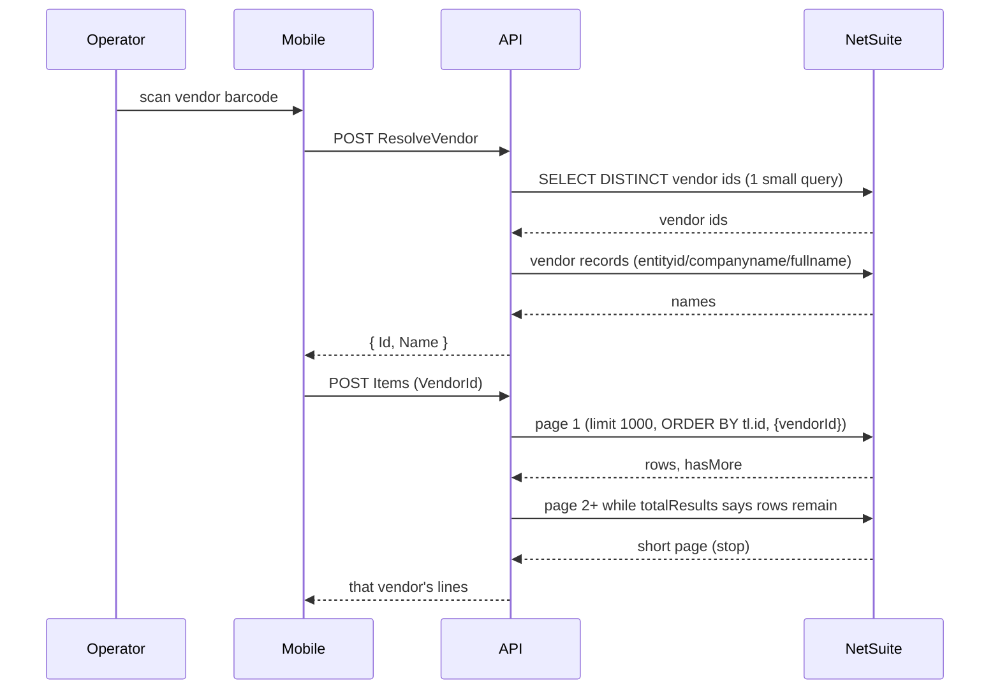

# Design — STR packing line read: completeness, vendor scope, gate stability

**Date:** 2026-10-22
**Status:** Confirmed
**Mode:** BUGFIX
**Scope:** as `requirements.md`
**Spec:** `requirements.md` (sibling); implementation plan in `tasks.md`
**Related:** `.opencode/specs/2026-10-06-preferred-vendor-per-line/`, `.opencode/specs/2026-10-16-to-partial-fulfillment-if-fix/plan.md:77`, `.opencode/docs/changes/2026-10-21-mobile-str-vendor-gated-fulfillment.md`

## Decision record

| # | Problem | Decision | Rationale / trade-off |
|---|---|---|---|
| **D1** | `NetsuiteQuery` drops `hasMore` (`NetSuiteApiClientService.cs:916-918`), so rows past 1,000 vanish | Loop pages of 1,000 **in `MGetTransferOrderLineQryHandler`** via a new `NetsuiteQueryWithMetadata`, terminating on `totalResults` / `hasMore` and never probing past the end; after the loop, fail if the collected rows do not account for the last reported total | NetSuite answers a request at `offset == totalResults` with `404 INVALID_PARAMETER`, not an empty page, so the short-page-probe termination would fail an exact multiple of 1,000. The metadata method is additive on `INetSuiteApiClientService` (and `NetsuiteQuery` now delegates to it), so no existing caller changes; the four test fakes gain a throwing stub. A short page that contradicts the reported total fails loudly instead of returning the original defect in a new shape. |
| **D2** | No stable row order; SuiteQL gives no ordering guarantee across requests | Add `ORDER BY tl.id` to the script **before** paging is enabled | `tl.id` is unique per line, so the order is total. Without it, two pages can overlap or skip rows — especially across the correlated subqueries and hash joins in this script. |
| **D3** | 4 duplicate rows observed (1,661 vs 1,657) | Pre-aggregate the four bare `inventorybalance` joins (`sql:118-142`) with `SUM`, grouped on `(item, location, binnumber, inventorystatus)`, mirroring `ibli1`/`ibli2` (`:144-186`) | Fixes the cause, not the symptom. `SELECT DISTINCT` would not help: the duplicated rows differ in quantity columns. Must land **before** D1 — a duplicate can otherwise straddle a page boundary. |
| **D4** | Resolver performs a full 1,657-row read to obtain a handful of vendor ids | Dedicated candidate query returning **vendor ids only**; handler then enriches via `GetVendorsByIdsAsync` | Justified by correctness (2.1), not only speed. **Names deliberately do not come from the script** — see D4a. |
| **D4a** | `BUILTIN.DF` is rejected inside `GROUP BY` on this account (verified: the aggregate query failed), and `DISTINCT` over a function is unproven | Candidate script returns `SELECT DISTINCT tl.custcol_dbti_vendor AS Id` only; names come from `entityid` / `companyname` / `fullname` via `GetVendorsByIdsAsync` | Uses only SuiteQL constructs already proven to run on this account. The vendor-record names are the ones the 2026-10-21 field test and its regression test (`TransferOrderVendorResolverTests.Resolves_from_the_vendor_record_when_the_line_display_name_differs`) showed decisive. Trade-off: the line's display name is no longer a candidate hint, and the rewritten tests can no longer represent a "line name matches, record names do not" scenario — that residual risk is accepted on field evidence. |
| **D4b** | `SELECT DISTINCT tl.custcol_dbti_vendor` emits a `NULL` row for any line without a vendor, and `VendorLookupDTO.Id` is a non-nullable `int` (`VendorLookupDTO.cs:11`); System.Text.Json (`JsonSerializerRequestOption`, `NetSuiteApiClientService.cs:214-218, 448`) throws converting `null` → `int`, failing the whole candidate read | Candidate script adds `AND tl.custcol_dbti_vendor IS NOT NULL`, and mirrors the line read's document-level filters (`custbody_dbti_transfer_category IN ('1','2')`, `status IN ('B','D','E')`) | The exclusion is semantically correct: a null vendor is not a candidate. `GetVendorsByIdsAsync` already guards `id > 0` (`VendorIntegration.cs:107`), but the crash happens at deserialization, before any handler code, and no unit test exercises the script→DTO boundary — so the guard must live in the script. A partially null-vendor document works today and would break without this. Mirroring the header filters keeps the candidate set a subset of the scoped line read's possible output, closing the race where a document's status changes between list load and scan (both the mobile list script and the line read apply the same filters). |
| **D5** | Change Vendor discards unsaved scans silently | Chained `Dialog.Confirm`: "Save first?" → yes: save, then switch; no: "Discard N scans?" → discard/cancel | No new dialog component. **Critical:** `ExecuteAppActionAsync` absorbs exceptions into `Result` and does not rethrow (`ActionFactoryService.cs:57-69`), so the caller must branch on `Result.Success`; a failed save must leave the gate on the current vendor. |
| **D6** | No feedback during the vendor resolve round trip | Inline indicator on the gate card driven by `_resolvingVendor`; show the resolved vendor as soon as it is known | `<Loading>` hides `ChildContent` (`Loading.razor:17`), which would blank the page header and back button. Progress bar dropped per the user's decision. |
| **D7** | A mid-page failure could return a partial set as success | Any page failure fails the whole read | Otherwise the original defect returns in a new shape. |
| **D8** | Guard against a runaway page loop | Cap the loop (e.g. 100 pages / 100,000 rows) and fail loudly on overflow | Stability: a server that always returns a full page would otherwise spin forever. The 100-page / 100,000-row ceiling sits at the neighbourhood of NetSuite's SuiteQL offset cap; verify the exact platform ceiling during implementation and document the cap as platform-aligned rather than arbitrary. |
| **D9** | Mobile reads all 1,657 rows per vendor scan to use ~17 | Add `AND ({vendorId} = 0 OR tl.custcol_dbti_vendor = {vendorId})` to the script; supply the parameter from the single handler that builds the dictionary | `{key}` is the codebase's raw-integer-splice form, validated by `SuiteQLText.IntegerList` (`:69-89`); `@key` would splice a quoted string against a numeric List/Record field. `0` is the "no scope" sentinel and passes that guard. No second script, no drift. |
| **D9a** | Prior decision `2026-10-16.../plan.md:77`: rows are not filtered in SQL, each consumer decides | Reconciled, not overridden: the new predicate is **call-scoped** (default `0` = all rows) and does **not** filter by state. The default reproduces today's row set byte-for-byte. | Preserves the earlier decision's intent (consumers decide) while removing a per-scan transfer of 1,657 rows. Recorded here because it touches a previously frozen behaviour. |

## What already exists (verified)

| Component | Location | Behaviour today |
|---|---|---|
| Packing line script | `Integration.NS/NSScripts/NS_TO_x_Packing_Get_Items.sql` | No `LIMIT`, no `ORDER BY`; WHERE filters `recordtype`, `custcol_dbti_transfer_category IN ('1','2')`, `status IN ('B','D','E')`, `transactionlinetype='SHIPPING'`, `tranid` (`:188-193`) |
| Line query handler | `Application.UseCases/Queries/Transaction/Packing/NS/TransferOrder/GetTransferOrderLineQry.cs:19-38` | Builds only `["tranid"]`; one unpaged call; in-memory vendor filter (`:31-36`) |
| Query transport | `Integration.NS/Services/NetSuiteApiClientService.cs:886-919` | Adds `limit`/`offset` only when `limit > 0`; returns `items`, discards `hasMore` |
| Response shape | `Application.DataTransferObjects/Others/NS/NetsuiteTransactionApiDTO.cs:18-32` | Already carries `count`, `hasMore`, `offset`, `totalResults` |
| Parameter rules | `Integration.NS/Helpers/SuiteQLText.cs:43-89` | `@key` → quoted escaped literal; `{key}` → validated integer list |
| Vendor resolver | `Application.UseCases/Queries/.../ResolveTransferOrderVendorQry.cs:34-66` | Reads all lines, then vendor records; pure matcher at `:74-225` |
| Vendor record read | `Integration.NS/Implementations/Others/VendorIntegration.cs:101-128` | `id IN (...)`; projects `entityid`, `companyname`, `fullname`; deliberately uncached |
| Save dedupe | `Integration.NS/Services/NetSuiteApiClientService.cs:1698` | Dedupes by `(LineSequenceNumber, IsBad, ScannedQuantity)` |
| Paging precedent | `Integration.NS/Helpers/SuiteQLQueryExtensions.cs:29-58` | Sequential paging, deliberately not parallel |
| Callers of the packing query | mobile `/Items`, web `ItemReceiptPackingHandler.cs:19,43`, resolver | Receiving uses a **separate** handler and script |

**Changes:** one SQL script edited, one SQL script added, one query handler, one resolver handler, one pure matcher signature, one Razor/component pair, test updates.
**Does not change:** save command and payload DTOs, web packing behaviour (still ungated, still fulfils the whole order), receiving/trip ticket/returns/VRA, database schema, print scriptlet.

## Overview and principles

- **Correctness first, and correctness must not depend on the caller.** Row completeness and uniqueness are properties of the read, not of each consumer.
- **Structural fixes over masking.** Aggregate the joins; do not `DISTINCT` the result.
- **Push the filter to the data source when the scope is known.** The gate always knows one vendor; use it.
- **Only ship constructs proven against this account.** `BUILTIN.DF` in `GROUP BY` and `ORDER BY <aggregate>` both failed in verification; neither appears in the design.
- **Fail loud, never partial.** A failed page or an exceeded page cap fails the read.
- **Preserve frozen behaviour by default value.** The vendor predicate defaults to today's row set.

## Flow



## Components and contracts

**SQL — `NS_TO_x_Packing_Get_Items.sql`**
- Add `ORDER BY tl.id`.
- Pre-aggregate `ibv1`, `ibv2`, `ibi1`, `ibi2` into `SUM`-grouped derived tables on `(item, location, binnumber, inventorystatus)`.
- Add `AND ({vendorId} = 0 OR tl.custcol_dbti_vendor = {vendorId})` to the WHERE block.
- No `--` comments anywhere in the file (`SuiteQLText.cs:92-114`).

**SQL — `NS_TO_x_Get_Vendor_Candidates.sql` (new)**
```sql
SELECT DISTINCT tl.custcol_dbti_vendor AS Id
FROM transactionline tl
JOIN transaction t ON tl.transaction = t.id
WHERE t.recordtype IN ('intercompanytransferorder', 'transferorder')
  AND t.custbody_dbti_transfer_category IN ('1', '2')
  AND t.status IN ('B', 'D', 'E')
  AND tl.transactionlinetype = 'SHIPPING'
  AND tl.custcol_dbti_vendor IS NOT NULL
  AND t.tranid = @tranid
```
Projection type: `VendorLookupDTO` (only `Id` is populated by the script; `Name` is filled from the vendor record read). `IS NOT NULL` and the mirrored category/status filters are D4b: the non-nullable `int` projection cannot receive a `NULL` row, and the candidate set must be a subset of what the scoped line read can return. No `GROUP BY`, no `BUILTIN.DF`, no `ORDER BY <aggregate>`.

**`MGetTransferOrderLineQryHandler`**
- Parameter dictionary becomes `{ "tranid": request.order.OrderNumber, "vendorId": scope }` where `scope = VendorId is > 0 ? VendorId.ToString() : "0"`.
- Paged loop: `limit = 1000`, `offset += 1000`; stop when `rows.Count` reaches the latest `totalResults`, on a shorter page, or on `hasMore == false`; cap at 100 pages and throw on overflow; propagate `CancellationToken`; concatenate `items`. A `null`/empty batch terminates only when it accounts for the reported total — otherwise the read throws. Never probe one page past the last row.
- `NetsuiteQueryWithMetadata<T>` is added to `INetSuiteApiClientService` and returns the `NetSuiteResponse<T>` envelope; `NetsuiteQuery<T>` delegates to it so every other caller is unchanged.
- Remove the in-memory vendor filter (the SQL is authoritative).

**`TransferOrderVendorResolver.Resolve`**
- Signature becomes `Resolve(IEnumerable<VendorLookupDTO>? candidates, IEnumerable<VendorDTO>? vendors, string? scannedVendor, string orderNumber)`.
- Candidate ids seed the name map; names come from the vendor records. Matching, normalization, ambiguity, and message rules are unchanged.

**`ResolveTransferOrderVendorQryHandler`**
- Sends the candidate query instead of `GetTransferOrderLineQry`; extracts ids with the same `is > 0` guard the line path uses today (`ResolveTransferOrderVendorQry.cs:47-51`); enriches via `GetVendorsByIdsAsync` (which filters `id > 0` again, `VendorIntegration.cs:107`); wraps in `try/catch` → `ApiResult.ServerError`.

**Mobile**
- `_resolvingVendor` drives an inline indicator on the gate card; the badge renders as soon as the vendor is resolved.
- `ChangeVendor` becomes a three-way prompt; switch only on `Result.Success`.
- Busy-flag comment records the invariant that the flag spans the item load.

## Correctness properties

- **CP1** — For any tranid with N > 1,000 SHIPPING lines, the read returns exactly N rows. *(1.1)*
- **CP2** — Returned `LineSequenceNumber` values are unique for any tranid. *(1.3)*
- **CP3** — Page composition is independent of page size: under a total order, concatenating pages equals one unbounded read, with no row appearing twice across a boundary. *(1.2, 1.5)*
- **CP4** — A scoped read returns exactly the lines whose vendor matches the scope; scope `0` returns every line the unscoped read returns. *(1.6, 1.7)*
- **CP5** — Any vendor present on the document resolves, regardless of its row position in the line read. *(2.1)*
- **CP6** — Resolution issues one candidate query and no full line read. *(2.2)*
- **CP7** — Changing vendor with unsaved scans switches if and only if the save succeeded. *(3.3, 3.4, 3.5)*
- **CP8** — Web and receiving callers receive a superset of today's rows; the web flow remains ungated. *(1.4, 4.2, 4.3)*
- **CP9** — A failure on any page, an exceeded page cap, or a page set that does not account for `totalResults` produces a failure, never a partial success. *(1.8, 1.9)*
- **CP10** — The candidate set contains no `NULL` or non-positive ids, and every candidate vendor's lines are returnable by the scoped line read for the same document (mirror filters). *(2.5, 2.6)*

## Error handling and user-visible behaviour

| Situation | Behaviour |
|---|---|
| Any page fails | Read fails; the existing `ActionGetTOItems.OnFailure` toast surfaces it; the previous list is retained. No partial list. |
| Page cap exceeded | Read fails with an explicit message naming the order. |
| Script parameter invalid | `SuiteQLText.IntegerList` throws locally, naming the parameter; nothing reaches NetSuite. |
| Resolver infrastructure fault | `ApiResult.ServerError` with a readable message (the API has no exception middleware). |
| No vendor on the document | Message names web Packing as the route. |
| Change Vendor, save fails | Gate stays on the current vendor; scans intact. |
| Change Vendor, discard chosen | Lists cleared; gate open. |

## Testing strategy

**Unit**
- Paging loop with a fake: page sizes and totals of 0 / 999 / 1,000 / 1,001 / 2,000; asserts concatenation, order, uniqueness, and call count.
- Page failure, a page set that falls short of `totalResults`, and page-cap overflow produce failure.
- Resolver: the 12 existing cases migrated to the candidate-based signature; new case — a candidate whose lines sit beyond row 1,000.

**Integration / shape**
- `StrPackingVendorFilterShapeTests` reworked: `tranid` still travels as `@tranid`; the vendor now travels as `{vendorId}`; unscoped calls send `0`; scoped calls send the id.

**Manual (SuiteQL console, no device)**
- Run the edited script with `{vendorId}` replaced by `0` and by a real id; confirm the unscoped row count equals the `COUNT(*)` for the tranid (1,657 on the sample).
- Re-run the join-fan-out comparison; expect `JoinedRows == DistinctLines`.
- Run the candidate script for the sample tranid; expect 95 ids. Also run it for a tranid with a null-vendor SHIPPING line: expect no `NULL` row and clean deserialization into `VendorLookupDTO` (its `Id` is a non-nullable `int`).

**Regression**
- Full `Integration.NS.Tests`; `dotnet build` across the solution; web packing path exercised via Postman with no `VendorId`.

**Property-based testing: APPLICABLE (partial).**
Generator-driven properties fit two pure surfaces: `TransferOrderVendorResolver` (normalization idempotence, strict/loose pass symmetry, single-match exclusivity) and the paging loop (arbitrary page sizes and totals versus a reference concatenation). No property-testing library is wired into `Integration.NS.Tests`, so express these as `[Theory]` cases with generated inputs unless adding one is approved. NetSuite I/O and the Razor screen are **NOT APPLICABLE** — example-based only.

## Blast radius

- Mobile list, scan handlers, and save-payload construction (all read through the same query).
- Web packing `ItemReceiptPackingHandler` — now sees every line instead of 1,000. Its save re-read also grows: `PostItemFulfillment` posts zero-quantity entries for every non-completed line, so the posted payload grows from ≤1,000 to ~1,657 entries on the sample — verify against NetSuite limits or record as accepted (4.6, T16).
- Vendor resolver — candidate source changes.
- Receiving — **not** affected (separate handler and script); to be proven by build plus unchanged tests.
- Save posting — **not** affected; duplicate rows were already removed by `DeduplicateFulfillmentLines`.
- Duplicate lines in the UI were a real over-scan risk before this change because the display is not deduped; after D3 the risk is removed at the source.

## Accepted consequences

- Orders above 1,000 lines cost one additional NetSuite round trip per extra page.
- The resolver contract changes; 12 tests are rewritten with behaviour preserved.
- The line's display name is no longer a vendor-matching hint (D4a); vendor-record names remain.
- Null-vendor documents remain unfillable on the handheld (accepted by the user).
- No device verification is available; device behaviour is carried as an open risk.

## Verification checklist

1. `JoinedRows == DistinctLines` on the sample tranid.
2. Unscoped read returns 1,657 rows; scoped read returns that vendor's line count.
3. Candidate script returns 95 ids for the sample tranid, with no `NULL` row and clean `VendorLookupDTO` deserialization (D4b).
4. Postman: unscoped `/Items` returns 1,657; scoped returns the vendor slice; timings recorded for the change doc.
5. Change Vendor: save-succeeds, save-fails, discard, cancel all behave per CP7.
6. Web `PostItemFulfillment` post succeeds with the grown payload, or the risk is recorded as accepted (4.6).
7. `dotnet build` all projects; `Integration.NS.Tests` green.
