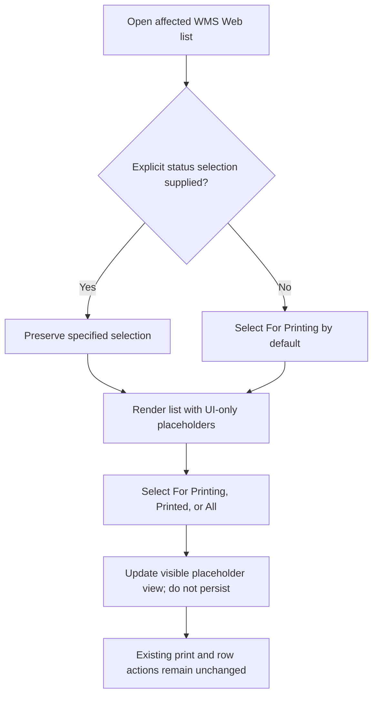

# Printed Document Indicator — Design

| Metadata | Value |
|---|---|
| Date | 2026-10-29 |
| Status | Confirmed |
| Mode | FEATURE |
| Scope | WMS Web print-status UI for specified transaction pages; UI-only placeholders, with NetSuite integration deferred |
| Related | None found |

## Decision record

- **Problem:** Users cannot readily distinguish records that need printing from those already printed or see a count in transaction lists.
- **Decision 1 — Status views:** Add For Printing, Printed, and All views to the affected lists, following the supplied mockup.
- **Decision 2 — Selection precedence:** For Printing is the default only when no status selection is specified. Existing explicit transaction-tab and URL/query selections remain intact.
- **Decision 3 — Placeholder phase:** Keep status/count placeholders UI-only and visibly temporary. Do not claim NetSuite data has been retrieved or updated.
- **Decision 4 — Deferred semantics/integration:** Defer custom-field identifiers, field mappings, authoritative status behavior, and print-count semantics until consultation with the NetSuite administrator.
- **Trade-off:** The UI can be reviewed before backend fields are ready, but the placeholder views do not establish actual operational print history.

## What already exists

- The solution includes `Web.BlazorServer`, `Integration.NS`, application, domain, data-transfer, database, and test projects (`WMS.slnx:1–39`). The repository overview describes .NET 8, Blazor Server, EF Core, MediatR, and Mapster (`CLAUDE.md:3–17`).
- Receiving has Purchase Orders, Stock Transfer Request, Returns, and Receiving Reports page tabs (`Web.BlazorServer/Components/Pages/Transaction/Receiving/ReceivingPage.razor:20–39`). Receiving Reports has an existing print link (`ReceivingPage.razor:31–38`).
- The Inventory Stock Transfer Request page has Transfer Orders, Intercompany Transfer Orders, and Returns tabs, and reads/writes the selected transaction tab through the `Tab` query parameter (`Web.BlazorServer/Components/Pages/Transaction/StockTransferRequest/StockTransferRequestPage.razor:20–65`).
- Purchase Orders and Trip Tickets use `AppDataGrid`; Stock Transfer Request also uses `AppDataGrid`; Return to Supplier uses `QuickDataGrid` (`Receiving/Components/PurchaseOrderGrid.razor:8–75`, `StockTransferRequest/Components/STRDataGrid.razor:8–101`, `SupplierReturn/Components/SupplierReturnsDataGrid.razor:5–20`, `TripTicket/Component/TripTicketDataGrid.razor:4–47`).
- STR and Return to Supplier grids already expose print links (`StockTransferRequest/Components/STRDataGrid.razor:90–100`, `SupplierReturn/Components/SupplierReturnsDataGrid.razor:14–19`). The inspected Trip Ticket grid does not show a print action. The Packing Labels Web entry point was not identified during requirements/design inspection; locate it before implementation.
- `CLAUDE.md:19–30` references `.claude/` guides, but those files were absent in the inspected working tree. Detailed guidance from those missing files could not be verified.
- The repository guidance says new Blazor features use the Web handler/dispatcher pattern and components must not directly access MediatR, repositories, or `DbContext` (`.claude/architectural_debts.md:35–38`).

**Changes:** Add status-view UI and placeholder indicators/counts to the confirmed lists, preserving explicit selections. **Unchanged:** NetSuite integration, persistence, field creation, domain/DTO contracts, existing print behavior, and unrelated transaction workflows.

## Overview and principles

- Fit controls and indicators into the existing pages/grids.
- Keep placeholder selection and rendering UI-only; do not extend persistent DTO/domain contracts to simulate data.
- Preserve data providers, grid filters/settings, permissions, actions, and navigation.
- Preserve an explicitly supplied selection; default to For Printing only when none is supplied.
- Do not create a new print action. Verify the actual existing print entry points for Trip Tickets and Packing Labels before attaching status UI.

## Components and responsibilities

1. **Page-level tab/status controls:** Add the three status views to applicable lists. Keep page transaction tabs conceptually and behaviorally separate from print-status views. Preserve existing query-tab support, notably the Stock Transfer Request `Tab` parameter.
2. **Existing grids:** Render status and count placeholders for each displayed record using the grid’s existing loading/action structure. Do not represent placeholder filtering as a real NetSuite/server-side filter.
3. **Trip Tickets and Packing Labels:** First locate the actual Web list and existing print flow. Attach status UI at the verified list entry point without inventing or changing a print action.
4. **NetSuite integration:** No responsibilities in this phase. A later, separately designed integration will map the administrator-defined fields and agreed status/count semantics.

## Interaction flow

## Data and contracts

- No persistent data model, database schema, DTO, or NetSuite contract changes.
- No NetSuite custom-field identifiers or semantics are assumed.
- No count increment, print-status write, or server-side filtering is introduced.
- Placeholder status/count values remain isolated from real backend data. The later integration design must resolve how counts are defined for the displayed grid and how statuses map to custom fields.

## Correctness properties

- **P1 — Default selection (1.1):** With no supplied status selection, the initial status view is For Printing.
- **P2 — Explicit-selection preservation (1.1, 4.2):** A supplied status selection and existing transaction-tab/query selection are not replaced by the default.
- **P3 — View availability (1.2–1.4):** Each applicable list exposes For Printing, Printed, and All.
- **P4 — Placeholder transparency (1.5, 2.1–2.2):** UI values are visibly temporary and are not represented as backend-retrieved or persisted state.
- **P5 — No tracking side effect (2.3, 4.3):** Triggering an existing print action does not write or increment the placeholder count.
- **P6 — Scope isolation (3.1–3.2):** Status UI applies to only the specified record lists.
- **P7 — Regression preservation (4.1–4.3):** Existing data loading, filters, settings, permissions, row actions, print links, and navigation continue to function.

## Error handling and user-visible behavior

- Placeholder selection/rendering introduces no new backend error paths.
- If a list cannot support placeholder view filtering without changing its data contract, keep the UI explicitly placeholder-only and do not imply server-side filtering.
- Do not silently substitute real backend status/counts unless a later, approved integration is implemented.

## Validation strategy

- Use available Web UI/component testing infrastructure, if present, for defaults, explicit-selection precedence, switching views, and placeholder rendering.
- Otherwise record the lack of automated UI test infrastructure and perform manual regression checks; do not assume the NS integration test project provides Web UI coverage.
- Manually verify each in-scope list loads, existing actions still work, printing does not alter placeholder counts, and navigation/settings/permissions are preserved.
- **Property-based testing: NOT APPLICABLE.** The behavior is a small, deterministic set of view-selection and rendering cases; example-based UI/regression checks fit better.

## Accepted consequences and out of scope

- Placeholder status/counts do not provide authoritative print traceability.
- NetSuite custom-field creation, field mapping, status semantics, count semantics, persistence, and backfill are deferred.
- Mobile UI and unrelated transaction lists are out of scope.
- Adding or changing print actions is out of scope.

## Verification checklist

- [ ] Identify the exact Packing Labels Web list and existing print flow.
- [ ] Verify the Trip Ticket print flow and its list entry point.
- [ ] Confirm every in-scope list has the three status views and placeholder indicator/count.
- [ ] Confirm explicit selections win and For Printing is the unsupplied default.
- [ ] Confirm print actions do not update placeholder counts.
- [ ] Confirm existing page navigation, permissions, filters, and grids still work.
