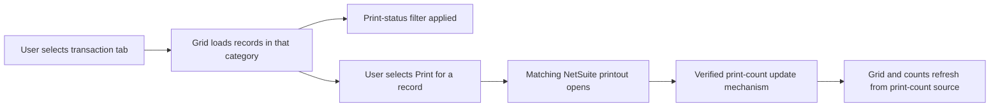

# Design — Receiving and Packing Print Workflows

**Date:** 2026-10-30  
**Status:** Confirmed  
**Mode:** FEATURE  
**Scope:** Integrate per-record print actions and print-status views across Receiving and Packing transaction tabs; remove standalone Receiving Reports and Packing Labels tabs; investigate and fix inaccurate Printed counts across pages using print-status views.  
**Related:** `.opencode/docs/print-button-on-document-rows.md` (implementation background; not a prior specification)

## Decision record

**Problem:** Print actions and print-status views are inconsistently available across transaction tabs and standalone tabs. Users also report that records remain in For Printing after printing.

**Decisions and rationale:**

- Keep existing Receiving and Packing transaction tabs as the primary place to find and print records.
- Add a per-record print action to every transaction tab inside Receiving and Packing, using the printout appropriate to that record type.
- Provide For Printing, Printed, and All views on every Packing tab. Preserve and verify existing status views in Receiving.
- Remove standalone Receiving Reports and Packing Labels tabs after their workflows are represented in transaction tabs.
- Trace the full count lifecycle. WMS currently filters using `t.custbody_wms_print_count`, while print links open external NetSuite scriptlets. Verify the mechanism updating that field before deciding where to fix it.

**Trade-offs:**

- Adding print actions may require missing internal IDs, query selections, mappings, or verified NetSuite printout support. Verify per document type; do not assume a shared URL.
- WMS cannot infer successful printing merely from opening an external link. Do not increment or mark printed on click without a verified success signal or authoritative update mechanism.

## What already exists

- `Web.BlazorServer/Components/Pages/Transaction/Receiving/ReceivingPage.razor:22-43` contains Purchase Orders, Stock Transfer Request, Returns, and standalone Receiving Reports. The standalone grid/print link is at lines 31-42.
- `Web.BlazorServer/Components/Pages/Transaction/Packing/PackingPage.razor:22-43` contains Stock Transfer Request, Returns, Returns to Supplier, and standalone Packing Labels. The standalone grid/print link is at lines 31-42.
- Receiving status views are used by `Receiving/Components/PurchaseOrderGrid.razor:8`, `TransferOrderGrid.razor:8`, and `ReturnsGrid.razor:8`.
- Existing row-level print actions include STR (`StockTransferRequest/Components/STRDataGrid.razor:96`) and Returns to Supplier (`SupplierReturn/Components/SupplierReturnsDataGrid.razor:18`). `.opencode/docs/print-button-on-document-rows.md:10-14` records the STR action across its three tabs.
- Packing STR, Returns, and Vendor Return Authorization grids currently expose row navigation but no row print action: `Packing/STR/Component/STRPackingDataGrid.razor:47-55`, `Packing/Returns/Component/ReturnsPackingDataGrid.razor:47-55`, and `Packing/VendorReturnAuthorization/Component/VendorReturnAuthorizationPackingDataGrid.razor:39-47`.
- Packing detail pages define scriptlet URLs and record-specific builders: `Packing/STR/Component/STRPackingDetails.razor.cs:29,85`, `Packing/Returns/Component/ReturnsPackingDetails.razor.cs:29,85`, and `Packing/VendorReturnAuthorization/Component/VendorReturnAuthorizationPackingDetails.razor.cs:30,86`.
- `Web.BlazorServer/Components/Custom/PrintStatusFilter.cs:17-27` filters using the NetSuite print-count field; For Printing checks null, Printed checks count >= 1, and All adds no print-count filter. `PrintStatusView.razor:33-49` loads counts and logs count-query failures.
- `Web.BlazorServer/Components/Shared/Others/NetSuitePrint.cs:15-53` builds URLs for Transfer Order, Vendor Return, and Trip Ticket. Other printouts remain at existing call sites.
- `.opencode/docs/print-button-on-document-rows.md:160-164` says the STR and Returns-to-Supplier row actions had not yet been functionally verified against NetSuite. Its lines 22-32 warn that IDs must be verified through query selection and mapping.

**What changes:** Add row print actions to all Receiving and Packing transaction tabs; ensure print-status views on all Packing tabs; remove standalone tabs; verify and correct count update lifecycle.

**What does not change:** Transaction categories, detail pages, print templates, and Blazor handler boundaries, except for verified changes needed to provide record-specific print actions or accurate counts.

## Overview and flow

## Verified technologies and design principles

- Solution: .NET 8, Blazor Server, EF Core/MSSQL, MediatR, Mapster, and NetSuite integration; solution projects are listed in `WMS.slnx`.
- UI follows Blazor feature handlers and thin dispatchers; components do not directly access MediatR or repositories (`.claude/blazor_conventions.md:3-15`).
- Reuse `PrintStatusView`, `PrintStatusFilter`, and `AppPrintLink` where they fit the verified transaction type.
- Validate internal IDs through the query → DTO → VM flow before building a row URL.
- Keep the NetSuite print-count source authoritative unless investigation verifies a different supported source.

## Components, responsibilities, contracts, and data

### Receiving and Packing pages

Page components retain transaction tabs and their URL/tab selection behavior. Remove standalone Receiving Reports and Packing Labels tabs and their tab-only state/handlers after relocating their workflows.

### Transaction grids

Each transaction tab provides a per-row print action for that row's corresponding document. Each mapping must use the verified document-specific printout and internal record ID. Existing STR and Returns-to-Supplier print actions must remain available.

### Print-status views and filters

Use the shared `PrintStatusView` and `PrintStatusFilter` patterns. Packing STR, Returns, and Returns to Supplier grids need status controls and category-scoped count/filter/reload behavior. Receiving's existing status views remain and are verified for consistency. Counts must include the same applicable category, date range, and active filters as the grid.

### Print-count integration

Trace which printout script/service updates `custbody_wms_print_count`. Fix the verified source and refresh counts once the update is visible. Do not locally or optimistically increment on link invocation. If a required external NetSuite change is outside this repository, record that dependency and validate it in the available NetSuite test environment.

### Data and contracts

- No database schema change is proposed.
- Inspect each tab's row VM, DTO, and NetSuite query to confirm the printout's required internal ID is selected and mapped.
- Add only the necessary ID/query/DTO/VM plumbing following existing conventions.
- Do not assume standalone Packing Label fulfillment records are interchangeable with Packing transaction rows; verify the mapping per type.
- Do not add local count writes unless the authoritative source and ownership are verified.

## Correctness properties

1. **Category isolation:** Selecting a status only returns records for the current transaction category. _(Requirements 1.1, 1.2, 3.1)_
2. **Record identity:** A row print action passes that row's verified internal ID. _(Requirements 1.3, 5.1)_
3. **Complete tab coverage:** Every Receiving and Packing transaction tab has its corresponding row-level print action. _(Requirements 1.3, 3.1)_
4. **No false success:** Failed or merely opened print actions do not by themselves mark a record printed. _(Requirements 4.1, 4.3)_
5. **Count consistency:** Grid records and Printed counts agree for the category and active filters. _(Requirement 4.2)_
6. **Status preservation:** For Printing and All retain established meanings; Printed reflects the verified count source. _(Requirements 4.1, 5.1)_
7. **Standalone removal:** Removing standalone tabs does not remove their applicable workflows. _(Requirement 2.1)_
8. **Invalid mapping handling:** Missing IDs or unverified mappings do not produce misleading print links. _(Requirement 1.4)_

## Error handling and user-visible behavior

- Retain existing shared `AppPrintLink` behavior where used.
- If a record lacks a valid print ID, hide or disable its print action rather than opening a malformed URL.
- Count refresh failures must not be silently represented as a valid zero. Retain observable logging and define any additional user-visible fallback during implementation.
- If NetSuite updates asynchronously, refresh after the update becomes visible; do not optimistically mark printed.

## Testing and validation strategy

- **Unit/component:** Verify status filter behavior, category-scoped count callbacks, invalid-ID link behavior, and URL construction for applicable builders.
- **Integration:** Verify relevant NetSuite queries select/map required internal IDs and support print-count filtering. Use `Integration.NS.Tests` where applicable.
- **UI/regression:** Check print action on every Receiving/Packing tab; Packing status controls; status/category filtering; removal of standalone tabs; navigation and filters.
- **End-to-end:** In NetSuite test environment, print controlled records for each supported scriptlet family and verify the source count field and WMS Printed count. Test failed/aborted print when supported.
- **Cross-page count investigation:** Exercise all pages using `PrintStatusView` and determine whether the issue is common or script/type-specific.

**Property-based testing assessment: NOT APPLICABLE.** Key risks are mapping, external printout behavior, and UI integration; focused examples and integration validation are more direct.

## Accepted consequences and out-of-scope items

- External NetSuite scriptlets are runtime dependencies and may require a change outside this repository for count updates.
- Printout templates and unrelated NetSuite behavior are unchanged unless required for the confirmed workflows/count fix.
- Trip Ticket remains out of scope unless its print-count field and printout behavior are verified.
- No broad transaction-grid refactor is planned.

## Verification checklist

- [ ] Every transaction tab in Receiving and Packing has a corresponding per-row print action.
- [ ] Every Packing tab has For Printing, Printed, and All views.
- [ ] Standalone Receiving Reports and Packing Labels tabs are removed without losing workflows.
- [ ] Each print action uses correct printout mapping and internal record ID.
- [ ] Existing STR and Returns-to-Supplier print actions remain functional.
- [ ] Printed count update is verified against the authoritative source.
- [ ] Printed counts match category and active filters.
- [ ] Failed/aborted printing does not create false Printed status.
- [ ] Existing transaction navigation, filters, and details remain functional.
