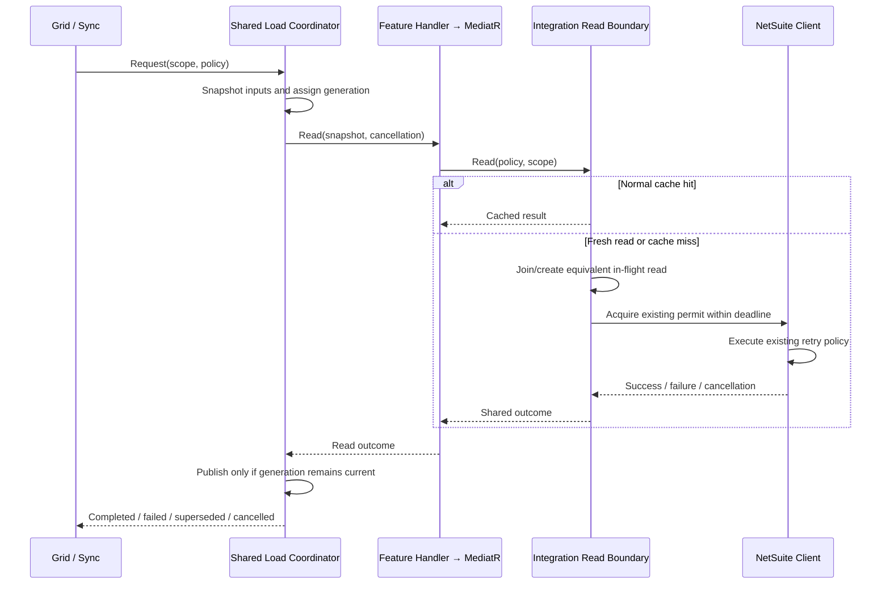

# Design — Web Grid Refresh Reliability and NetSuite Capacity Optimization

- **Date:** 2026-11-06
- **Status:** Confirmed
- **Mode:** BUGFIX
- **Baseline reviewed:** `2671287d`
- **Scope:** Packing/Receiving grid reliability, shared loading coordination, read freshness, cancellation, coalescing, and capacity diagnostics.
- **Related:**
  - [Interim NetSuite optimization](../2026-10-07-netsuite-interim-optimization/design.md)
  - [Web data-fetch optimization](../2026-10-08-web-fetch-optimization/design.md)
  - [Packing/receiving performance](../../../docs/packing-receiving-performance.md)
  - [SuiteQL shape rules](../../docs/SuiteQL-Shape-Rules.md)
- **Companions:** [Requirements](requirements.md), [Tasks](tasks.md)

## 1. Problem and Root-Cause Boundaries

### Confirmed defects

- Shared load entry points provide inconsistent ordering and completion.
- Receiving Sync can reuse completed cache entries.
- Failed reads can publish empty datasets.
- Failed badge refreshes can leave unmarked stale totals.
- Packing status selection triggers unnecessary badge reads.
- Some read paths drop cancellation.

### Accepted infrastructure limitation

The limiter is process-local. Its default of two operations per process follows the interim design; it is not an account-wide admission mechanism. Both hosts' budgets, other consumers, and deployment overlap must be considered against the fixed five-slot account limit.

### Unproven latency causes

The reported 10–15 seconds have not been attributed conclusively to admission wait, retries, SuiteQL execution, repeated callbacks, or rendering. Query changes remain measurement-gated.

Auto-fulfillment investigation and optimization are excluded. The user permits separately scoped disabling/removal if later evidence implicates the unused feature; no such removal is scheduled here.

## 2. Decision Record

### D1 — One grid-load coordinator

_Requirements: 1.1–1.4, 8.1–8.3._

Route Radzen loads and direct reload methods through one coordinator in the existing shared grid abstraction. Capture independent inputs, run at most one active load per grid instance, retain only the latest pending request, reject superseded publication, and complete callers with explicit outcomes.

**Trade-off:** More shared-grid state management, but no separate implementations for Sync, paging, and filter changes.

### D2 — Separate normal reads from explicit fresh reads

_Requirements: 2.1–2.3._

Introduce an explicit internal policy:

- **Normal:** Existing completed cache entries may satisfy the read.
- **Fresh:** Bypass completed-result cache lookup while allowing safe in-flight sharing.

Successful fresh reads may update the normal cache. Policy is not encoded as a fake filter, timestamp, or random key parameter.

**Trade-off:** Sync intentionally consumes an upstream read; coalescing limits duplicates without misrepresenting freshness.

### D3 — Preserve valid data, expose refresh failure

_Requirements: 3.1–3.5._

Same-scope failure retains the last successful dataset with stale/error feedback. Changed-scope failure does not label prior rows as matching the new scope. Successful zero-row results remain distinct from failures. A successful write followed by read failure produces "Refresh needed," not "Write failed."

### D4 — Coalesce reads without extending transaction staleness

_Requirements: 4.3–4.5._

Add bounded, identity-scoped in-flight sharing at the integration read boundary. Share success and failure, remove completed entries, and do not persistently cache exceptions. Do not add a Packing result-cache TTL in this first patch.

**Trade-off:** Reduces overlapping duplicate reads, not every repeated read or simultaneous request from different users.

### D5 — Cancel obsolete reads without weakening write safety

_Requirements: 5.1–5.5._

Propagate cancellation through touched read paths. Each caller independently cancels its wait; shared work is cancelled only when no valid callers remain. Existing write-retry and uncertain-outcome behavior remains unchanged.

### D6 — Bound admission, retain the existing total limiter

_Requirements: 5.3, 6.1–6.3._

Add a configurable interactive admission-wait deadline, distinct from HTTP timeout:

- Confirmed initial default: **10 seconds for applicable interactive reads**.
- Expiry returns a typed busy outcome.
- Cancellation while queued sends no request.
- Do not create a second independent request budget.
- Do not change permit ownership during retry backoff in this patch.

**Trade-off:** Under saturation, users receive an actionable busy state rather than waiting indefinitely. Check the default against hosted measurements. This is not a ten-second HTTP timeout or an end-to-end latency guarantee.

### D7 — Optimize SQL only after attribution

_Requirements: 6.4–6.5, 7.1._

Retain query shapes initially. Change aggregate scope only when measured execution cost justifies it and equivalence checks preserve eligibility, totals, and pagination.

## 3. What Already Exists

Paths and lines refer to the reviewed baseline and must be re-checked before implementation.

| Component | Evidence | Relevant behavior |
|---|---|---|
| Shared grid | `Web.BlazorServer/Components/Shared/Abstraction/AppDataGrid.razor.cs:111–269` | Queues Radzen loads, but direct reloads bypass the queue; publication/completion are inconsistent |
| Quick grid toolbar | `Web.BlazorServer/Components/Custom/QuickDataGrid.razor:19`; `.razor.cs:107–111` | Toolbar direct reload and public Radzen-backed reload use different entry points |
| Action failure capture | `Web.BlazorServer/Services/Implementation/AppActionFactory.cs:48–60` | Captures cancellation/failure rather than throwing to the loader |
| Packing orchestration | `Web.BlazorServer/Components/Pages/Transaction/Packing/STR/Component/STRPackingDataGrid.razor.cs:33–62,132–133` | Global badge scope, status/refresh orchestration, failed-result conversion |
| Receiving cached reads | `Integration.NS/Implementations/Others/Caching/CachedReceivingIntegration.cs:20–38` | Lists and aggregate badges use ordinary cache lookup |
| Cache identity/generation | `Integration.NS/Implementations/Others/Caching/GridResultCache.cs:97–105,150–206,214–263` | Identity-keyed entries, generation invalidation, success-dependent miss serialization |
| Badge lifecycle | `Web.BlazorServer/Components/Custom/PrintStatusView.razor:52–105` | Cancellation and latest-version checks, no stale marker after aggregate failure |
| NetSuite client | `Integration.NS/Services/NetSuiteApiClientService.cs:125–133,349–351,438–495` | Process-local budget, admission, retries, timing logs |
| Retry safety | `Integration.NS/Resilience/NetSuitePipelines.cs:60–84` | Read transient retry; writes retry 429 only |

**Changes:** Read coordination, internal read contracts, refresh state, targeted cancellation/coalescing, admission deadlines, and diagnostics.

**Unchanged:** Database schema, fulfillment payloads, posting rules, authentication, SAP/mobile workflows, and auto-fulfillment implementation.

## 4. Architecture and Interaction Flow

Verified stack: .NET 8 Web/NS integration, .NET 9 API, Blazor Server, Radzen, MediatR, existing memory-cache decorators, and Polly. Do not introduce another service abstraction merely to reconcile conflicting legacy architecture diagrams; follow the existing feature's verified dispatch path.



Components continue calling feature-handler interfaces. No direct component access to MediatR, caches, repositories, or NetSuite services is introduced.

## 5. Components and Internal Contracts

### Shared grid coordinator

Owns the active/latest-pending request, generation, last successful scope/result, loading/stale/failure state, and each caller's completion outcome.

Outcome categories:

```csharp
Succeeded
Failed
Cancelled
Superseded
Busy
```

A successful empty dataset is `Succeeded` with zero rows. Final owning type locations/names must follow existing conventions and are an investigation step in Tasks, not an invented public API.

### Read policy

Thread an internal `Normal` / `Fresh` policy through feature handlers, queries, and integration decorators. Do not encode policy as part of business filters.

### In-flight read store

Use existing identity/subsidiary/intent keying principles plus mutation generation.

- Fresh reads do not join older normal reads whose freshness cannot satisfy the request.
- Equivalent fresh reads already started for the same current scope and mutation generation may share work.
- A pre-mutation read must not satisfy post-mutation reconciliation.
- Each caller has independent cancellation of its wait.
- Remove completed work, including failures; no persistent exception cache.

### UI state

- Loading for initial reads.
- Refreshing while retaining same-scope successful rows.
- Stale/error plus Retry after reconciliation failure.
- Distinct current-scope failure when filters change.
- Stale badge totals until successful reconciliation.

### Schema and external contracts

No database migration and no public endpoint. Internal signatures may change to carry read policy, cancellation, and outcomes. DTOs remain separate from presentation ViewModels.

## 6. Correctness Properties

1. **Latest-result publication:** Obsolete generations never replace current rows or totals. _Requirements: 1.2._
2. **Truthful completion:** Refresh completion represents reconciliation or an explicit non-success outcome. _Requirements: 1.3._
3. **Fresh Sync:** Completed cache entries alone cannot satisfy explicit refresh. _Requirements: 2.1._
4. **Failure separation:** Failed reads never publish successful empty data. _Requirements: 3.1–3.4._
5. **Scope isolation:** Different authorization/subsidiary scopes never share protected results. _Requirements: 4.4._
6. **Safe shared cancellation:** One cancelled waiter cannot cancel another valid caller's read. _Requirements: 4.5._
7. **No send after queued cancellation:** Cancellation or admission expiry before acquisition produces no upstream request. _Requirements: 5.2–5.3._
8. **Write preservation:** Changes introduce no additional retry of uncertain writes or removal of posting validation. _Requirements: 5.5; Preservation Requirements 4–6._

## 7. Request Reduction

Packing print-status selection reloads affected rows without recalculating unchanged global badge totals. Badges still reconcile on initial load, explicit Sync, successful relevant mutations, and changes to badge-defining scope.

Post-print row/modal/badge reconciliation remains functionally intact. Do not indiscriminately serialize all reads or remove necessary refreshes merely to lower request counts.

## 8. Bug Examples and Blast Radius

- **Queued Packing refresh:** A is active; B is queued and returns early; A publishes; B executes later. The coordinator must prevent obsolete publication and give B truthful completion.
- **Direct reload race:** Direct reload A starts; newer Radzen load B publishes; A finishes and overwrites B. All entry points must share coordination.
- **Receiving Sync cache hit:** A successful page is cached; external data changes; unchanged Sync returns the completed entry. Explicit refresh must use fresh policy.
- **Failed same-scope refresh:** Previously populated grid receives 429; failure handling produces empty rows. Retain valid data with error feedback instead.

Shared-grid changes affect non-Packing consumers as well as the reported pages. Scope the feature-loader adaptations to affected consumers and test shared entry points. Do not treat every existing consumer as requiring an unrelated redesign.

## 9. Validation Strategy

### Phase A — Demonstrate defects

Use controlled asynchronous fakes to reproduce old/new response ordering, early queued completion, direct reload bypass, completed-cache Sync, empty-on-failure publication, and unmarked badge failure. Demonstrate failures against unfixed behavior where feasible and record any limitation.

### Phase B — Verify fixes

Extend existing integration and bUnit projects for unified entry points, fresh reads and mutation generations, true overlapping coalescing including shared failure, independent waiter cancellation, admission expiry/permit recovery, and no redundant Packing badge query on status selection.

### Phase C — Preserve unaffected behavior

Verify saved paging/settings and selection; empty results, sorting, filters, and operator-controlled dates; authorization/subsidiary separation; bin/non-bin and remaining-quantity guards; print success followed by reconciliation failure; and existing write-safe retries/uncertain outcomes.

**Property-based testing: NOT APPLICABLE to the core fix.** Deterministic overlap/barrier tests are more appropriate for these lifecycle/concurrency invariants.

Hosted verification compares equivalent cold/warm loads and representative concurrent usage. No production load generation is authorized by this package. Previously passing suites are a review baseline, not proof that the future implementation works or improves production latency.

## 10. Accepted Consequences and Deferred Work

- Fresh Sync consumes an upstream read to improve freshness.
- Process-local admission depends on deployment-wide budget discipline.
- Cancellation does not prove remote NetSuite execution stopped.
- Coalescing does not guarantee faster execution of one expensive query.
- No specific latency reduction is promised before hosted measurements.
- Distributed admission, query rewrites, and auto-fulfillment removal remain separate decisions.
- If the unused auto-fulfillment feature is later implicated, prefer separately scoped disabling/removal over optimization.

## 11. Verification Checklist

- [ ] Every shared-grid load entry point uses the coordinator.
- [ ] Superseded responses cannot publish.
- [ ] Explicit Sync has fresh-read semantics.
- [ ] Failed reads do not become empty success.
- [ ] Stale rows and badges are visibly identified.
- [ ] Packing status selection does not issue redundant badge reads.
- [ ] Shared reads preserve identity and cancellation boundaries.
- [ ] Admission wait is bounded independently of HTTP timeout.
- [ ] Existing posting safeguards remain unchanged.
- [ ] Deployment capacity assumptions and hosted timings are recorded.
- [ ] No auto-fulfillment changes are included.
