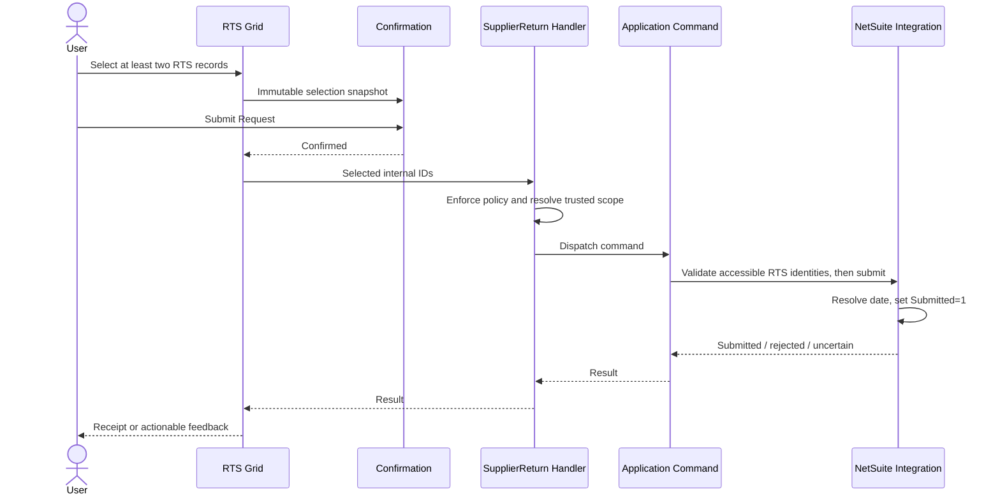

# Bulk Fulfillment Submission — Design

- **Date:** 2026-11-09
- **Status:** Confirmed
- **Mode:** FEATURE
- **Scope:** Web RTS selection, confirmation, and NetSuite BF record creation.
- **Related:** [requirements.md](requirements.md), [tasks.md](tasks.md)

The user confirmed this design, including preservation of at least two unique selected RTS records. Earlier conversational dates were corrected to the package writing date without changing the approved scope.

## 1. Decision Record

The UI currently opens a confirmation shell but cannot submit. Extend the existing Supplier Return pipeline, create one BF record per confirmed selection, set business date and Submitted `1` server-side, return a submission receipt, and do not automatically retry ambiguous writes. Do not add a controller, queue, worker, IF engine, local BF schema, or monitoring dashboard. These decisions implement requirements 5.1–5.6 and 6.1–6.3.

Preserve the minimum of two unique RTS IDs. Confirmed acceptance is distinct from downstream fulfillment and from accepted-without-reference exception handling.

## 2. What Already Exists

Paths/lines reflect the reviewed snapshot; recheck before implementation.

| Area | Evidence |
| --- | --- |
| Minimum-two action | `Web.BlazorServer/Components/Pages/Transaction/SupplierReturn/Components/SupplierReturnsDataGrid.razor:15–16` |
| ID selection, snapshot, dialog, reload clearing | `Web.BlazorServer/Components/Pages/Transaction/SupplierReturn/Components/SupplierReturnsDataGrid.razor.cs:26–29,49–72,88–92` |
| Disabled confirmation, Rows parameter, display search | `Web.BlazorServer/Components/Pages/Transaction/SupplierReturn/Components/BulkFulfillConfirmation.razor:27–41` |
| Web contract | `Web.BlazorServer/Handlers/Repositories/Transaction/SupplierReturn/ISupplierReturnHandler.cs:9–23` |
| Thin dispatcher | `Web.BlazorServer/Handlers/Implementations/Transaction/SupplierReturn/SupplierReturnHandler.cs:21–51` |
| Command precedent | `Application.UseCases/Commands/Transaction/SupplierReturn/CreateSupplierReturnCmd.cs:12–19` |
| Integration contract | `Application.UseCases/Repositories/Integration/Transaction/SupplierReturn/ISupplierReturnIntegration.cs:12–26` |
| Existing RTS creation, not BF creation | `Integration.NS/Implementations/Transactions/SupplierReturnIntegration.cs:243–259` |
| Cache decorator | `Integration.NS/Implementations/Others/Caching/CachedSupplierReturnIntegration.cs:13–21,51–68` |
| Client dispatch, empty success, error handling | `Integration.NS/Services/NetSuiteApiClientService.cs:471–525,567–618` |
| Write retry, 429 only | `Integration.NS/Resilience/NetSuitePipelines.cs:73–84` |

Change confirmation, add one application/integration operation, and add narrowly scoped creation-response support. Individual RTS creation, scanning, packing, IF creation, and NetSuite processing remain unchanged.

## 3. Technologies and Constraints

Relevant projects use .NET 8, Blazor Server/Radzen, MediatR, Mapster, and the NetSuite integration with Polly. Existing test projects use xUnit/WireMock and xUnit/bUnit/NSubstitute. The solution is not uniformly .NET 8: the reviewed API project targets .NET 9; no API project change is proposed.

Follow `.claude` component/handler, async, authorization, result/error, and integration guidance. Authorization remains at the presentation entry point; trusted scope informs authoritative data validation. Do not introduce direct component MediatR/repository/client access. Preserve documented debts rather than consolidating layers. SAP, Mobile, and database migrations are not applicable to this scoped feature.

## 4. Flow

No stage invokes IF creation.

## 5. Responsibilities and Contracts

### 5.1 Grid and dialog

The grid owns an immutable selection snapshot and an in-flight guard spanning dialog opening through submission. The dialog displays references/count and returns confirmation/cancellation, not an integration call. Search filters visibility only; show selected count separately from matching count. Confirmed acceptance clears selection. Rejection preserves it. This implements 5.1, 5.2, and 5.5.

### 5.2 Presentation handler

Extend `ISupplierReturnHandler` and its implementation. Apply the existing applicable permission policy, resolve trusted access scope, dispatch the command, and preserve result distinctions. Identify the actual policy during implementation prerequisite work; no invented policy name is prescribed. Browser IDs do not establish authorization. Implements 5.3.1 and 6.3.

### 5.3 Application command

Proposed `SubmitBulkFulfillmentCmd` accepts a small DTO of RTS IDs, rejects nonpositive IDs, deduplicates, requires at least two unique IDs, coordinates authoritative RTS/access-scope validation, and calls the dedicated integration operation. Expected business failures use repository result conventions; unexpected failures retain exception handling. A local DB transaction cannot roll back this external write. Implements 5.1.2–5.1.3, 5.3, 5.4.1, 5.4.6.

### 5.4 Integration

Extend `ISupplierReturnIntegration`, concrete implementation, and cache decorator. Validate selected IDs against accessible RTS transactions before writing. Build a typed payload and create one BF record. The decorator forwards; do not mark cached RTS records fulfilled. Proposed endpoint, pending account verification: `POST /record/v1/customrecord_bulk_fulfillment`.

| Field | Value |
| --- | --- |
| `custrecord_bf_date` | Server-resolved submission business date |
| `custrecord_bf_status` | Submitted internal ID `1` |
| `custrecord_bf_return_to_supplier_ids` | Unique confirmed RTS references |
| `custrecord_bf_error_message` | Omitted |

Verify actual REST field serialization, role permissions, mandatory fields, and response contract before finalizing the wire DTO. RESTlet examples are not evidence of REST Record API multi-select/date encoding. Implements 5.3.3–5.4.6.

### 5.5 Result and creation-response support

Return a typed result distinguishing Submitted, Rejected, and Uncertain, with BF ID when available and appropriate message. Current generic requests discard headers; add an additive, narrowly scoped creation-response method exposing status, Location when available, and any needed body. Preserve existing callers. Parse IDs from the verified response representation, handling valid absolute/relative locations and malformed/missing references.

Confirmed success with no recoverable ID is accepted-without-reference, not rejection: “Request submitted, but its reference could not be retrieved. Check NetSuite before submitting again.” Do not POST again. This approved exception to the normal receipt path preserves truthful acceptance handling (5.4.5, 5.5.2, 5.6).

### 5.6 Date

Resolve the business date server-side using an explicit agreed timezone. Do not use browser date, unqualified server-local date, or a copied RESTlet format. Identify existing authoritative configuration/clock abstractions first. The timezone remains a prerequisite decision. Implements 5.4.2–5.4.3.

## 6. Error Handling

| Condition | Behavior |
| --- | --- |
| Invalid/inaccessible selection | No create; explain and preserve selection |
| Definitive NetSuite rejection | Sanitized actionable error; preserve selection and restore controls |
| Timeout, connection loss, ambiguous server failure | Uncertain; verify NetSuite before resubmission; no automatic retry |
| Confirmed creation with ID | Submitted receipt; clear selection; no fulfillment claim |
| Confirmed creation without ID | Accepted with missing-reference warning; no retry |

Preserve existing write-safe 429 retries; do not expand to network/timeouts/arbitrary 5xx. Preserve cancellation without falsely asserting that cancellation means no remote creation. No credentials/session metadata in logs. Implements 5.5, 5.6, 6.4.

## 7. Correctness Properties

1. Submitted RTS references equal the unique confirmed selection, independent of dialog search. _Requirements: 5.1.2–5.1.3, 5.2.4._
2. Initial status is Submitted `1`, independent of arbitrary browser input. _Requirements: 5.4.2–5.4.3._
3. Invalid, non-RTS, or inaccessible IDs cause no BF creation. _Requirements: 5.3.1–5.3.4._
4. A component workflow has at most one active submission. _Requirements: 5.5.1._
5. No IF/inventory-allocation mutation is invoked. _Requirements: 5.4.6, 6.1._
6. Outcomes reflect evidence: acceptance is not fulfillment; ambiguous failures are not definite rejection or blind retries. _Requirements: 5.5.2–5.5.3, 5.6.1–5.6.3._
7. Submission date follows the agreed timezone, including midnight boundaries. _Requirements: 5.4.2–5.4.3._

## 8. Validation Strategy

Use `Integration.NS.Tests` for serialization, unique references, date boundaries, 204/empty success, reference parsing, missing/malformed reference, rejected/uncertain outcomes, retries, and absence of IF calls. Relevant existing resilience tests: `Integration.NS.Tests/Services/NetSuiteApiClientServiceResilienceTests.cs`.

Use `Web.BlazorServer.Tests` for confirmation/cancellation, minimum-two rule after deduplication, search invariance, double submission, selection clearing/preservation, uncertainty, and authorization. Identify the suitable existing test host for command-level tests before implementation.

An explicitly authorized sandbox check must verify real wire compatibility, required fields, role permissions, date/status/references, creation receipt, and no additional WMS writes. Mocks cannot prove target-account serialization compatibility.

**Property-based testing: NOT APPLICABLE as a required MVP dependency.** Parameterized tests cover the bounded ID normalization/date-boundary contract without introducing another framework.

## 9. Consequences and Non-goals

One synchronous custom-record request needs no worker. No monitoring means users inspect processing in NetSuite. No local persistence means no durable cross-session idempotency guarantee; uncertain outcomes require verification. A narrow additive client change avoids changing all existing requests. NetSuite optimistic locking does not guarantee duplicate prevention.

No IF creation, planned quantities, allocation, downstream status updates/retries, attachments, Mobile, local BF schema, or unrelated refactoring.

## 10. Verification Checklist

- [ ] Target-account field serialization and required fields verified.
- [ ] Integration role and applicable presentation policy verified.
- [ ] Trusted RTS scope query verified.
- [ ] Business timezone confirmed.
- [ ] Creation ID response and missing-reference handling verified.
- [ ] Minimum two unique IDs, snapshot/search invariance, cancellation, and busy state tested.
- [ ] No IF calls; individual workflows preserved.
- [ ] Rejection/uncertainty distinguished; retry behavior unchanged.
- [ ] NetSuite duplicate behavior documented.
- [ ] Authorized sandbox evidence and build/test results recorded.
